# Exhaustive Parser & Grammar Audit: Balanced Ternary Frontend (.bt)
**Target Files:**
- `ternary_frontend_ast.hpp` (AST, Lexer, Recursive-Descent Parser)
- `test_frontend_ast.cpp` (Frontend Verification Test Suite)
**Auditor:** Antigravity Prime Research & Engineering Engine (Parser & Grammar Auditor)
**Date:** October 2026

---

## 1. Executive Summary & Audit Matrix

An exhaustive static and empirical audit of the Universal Balanced Ternary Compiler frontend (`ternary_frontend_ast.hpp`) was conducted. While the basic pipeline (tokenization, recursive descent, AST hierarchy, and AST visitor printing) functions correctly on pristine, spaced benchmark programs (e.g., `bt_dot_product` and `ternary_signum`), the frontend exhibits **severe lexer ambiguities, operator precedence anomalies, brittle grammar recovery, and critical language gaps** that prevent `.bt` from operating as a robust general-purpose language.

### Severity Summary Table

| Category | Issue ID | Severity | Description | Empirical Verification Status |
| :--- | :--- | :--- | :--- | :--- |
| **Lexer** | `LEX-01` | **CRITICAL** | `x-1` and `x+1` without spaces fail to parse due to greedy literal tokenization | **PROVEN** (Throws `ParseError: Expected ';'`) |
| **Lexer** | `LEX-02` | **HIGH** | `prev_can_end_expression()` defined but dead code; never invoked | **PROVEN** (Zero calls in codebase) |
| **Lexer** | `LEX-03` | **HIGH** | 2-trit words (`+-`, `--`, `++`, `+0`, `-0`) fracture into separate operators | **PROVEN** (`+-` becomes `OpPlus` + `OpMinus`) |
| **Lexer** | `LEX-04` | **HIGH** | `+T-` and `-T+` fail to tokenize as multi-trit literals | **PROVEN** (`+T-` becomes `OpPlus` + `Ident(T)` + `OpMinus`) |
| **Lexer** | `LEX-05` | **HIGH** | Crash via uncaught `std::stoll` `out_of_range` on large 0-prefixed numbers | **PROVEN** (`0999...` terminates process with exception) |
| **Lexer** | `LEX-06` | **MEDIUM** | Unclosed block comment (`/* ...` to EOF) silently accepted without diagnostic | **PROVEN** (Reaches EOF with zero error) |
| **Lexer** | `LEX-07` | **HIGH** | Missing string literal (`"..."`) and escape sequence lexing | **PROVEN** (`"` emits `TokenType::Error`) |
| **Parser** | `PARSE-01` | **CRITICAL** | Unary plus (`+x`, `+(a*b)`) broken; parses `+` as `LiteralNode(+1)` | **PROVEN** (Throws `ParseError: Expected ';'`) |
| **Parser** | `PARSE-02` | **HIGH** | Flattened comparison precedence: `<=>`, `==`, `!=`, `<`, `>` share same level | **PROVEN** (`a < b == c < d` parsed as `(((a < b) == c) < d)`) |
| **Parser** | `PARSE-03` | **MEDIUM** | Chained `else if` disallowed; requires nested curly braces `else { if ... }` | **PROVEN** (Throws `Expected '{' to start block`) |
| **Parser** | `PARSE-04` | **HIGH** | Missing division (`/`) and modulo (`%`) operators entirely | **PROVEN** (`/` treated as comment/error) |
| **Parser** | `PARSE-05` | **MEDIUM** | Empty statement `;` and trailing loop semicolons throw parse errors | **PROVEN** (`while() {};` throws on `;`) |
| **Parser** | `PARSE-06` | **CRITICAL** | Zero error recovery (no synchronization); panics on first syntax error | **PROVEN** (Abrupt throw prevents multi-diagnostic report) |
| **Memory** | `MEM-01` | **HIGH** | Universal `std::shared_ptr` AST overhead, 16-byte ptrs, atomic ref counting | **ANALYZED** (Zero unique_ptr or arena allocation) |
| **Memory** | `MEM-02` | **MEDIUM** | Memory leak hazard if future symbol/scope passes introduce back-pointers | **ANALYZED** (Lack of weak_ptr / non-owning ptr convention) |
| **Language**| `LANG-01` | **CRITICAL** | No tensor/array indexing or slicing syntax (`A[i]`, `A[i:j, k:l]`) | **PROVEN** (`[` emits delimiter, rejected in expressions) |
| **Language**| `LANG-02` | **HIGH** | No struct/record types, field access, or user-defined aggregate types | **AUDITED** (Language lacks dot `.` operator and struct AST) |
| **Language**| `LANG-03` | **HIGH** | No module import/export mechanism (`import "math.bt"`) | **AUDITED** (Single monolithic compilation only) |
| **Language**| `LANG-04` | **MEDIUM** | No static type checking pass or type inference engine | **AUDITED** (`var x = 1;` leaves `type = ""` unvalidated) |

---

## 2. Exhaustive Audit: Lexer Vulnerabilities & Edge Cases

### 2.1 The `x-1` and `x+1` Greedy Tokenization Bug (`LEX-01` & `LEX-02`)
In `ternary_frontend_ast.hpp`:
```cpp
// Lines 389-395
if (next == '1' && !std::isdigit(static_cast<unsigned char>(peek(2))) && !std::isalpha(static_cast<unsigned char>(peek(2)))) {
    advance(); advance(); // consume '+' and '1'
    Token tok{TokenType::TritLiteral, "+1", loc, 1, 1, {1}};
    prev_token_ = tok;
    return tok;
}
// Lines 426-433
if (next == '1' && !std::isdigit(static_cast<unsigned char>(peek(2))) && !std::isalpha(static_cast<unsigned char>(peek(2)))) {
    advance(); advance(); // consume '-' and '1'
    Token tok{TokenType::TritLiteral, "-1", loc, -1, -1, {-1}};
    prev_token_ = tok;
    return tok;
}
```
**The Flaw:**
When scanning source like `var res = x-1;`, `(a)-1;`, or `foo()-1;`:
1. The lexer reaches `-`.
2. `next` is `'1'`, and `peek(2)` is `';'` (neither digit nor alpha).
3. The lexer unconditionally matches this as `TokenType::TritLiteral` (`"-1"`).
4. The token stream produced is: `IDENT("x")`, `TRIT_LITERAL("-1")`, `DELIMITER(";")`.
5. The recursive-descent parser consumes `IDENT("x")` in `parse_primary()`. Returning to `parse_statement()`, it expects a semicolon or assignment operator, but finds `TRIT_LITERAL("-1")`.
6. Result: **Throws `ParseError: Expected ';' after variable declaration (found: TRIT_LITERAL '-1')`**.

**Root Cause:**
The lexer author actually implemented a helper function at line 249:
```cpp
bool prev_can_end_expression() const {
    switch (prev_token_.type) {
        case TokenType::Ident:
        case TokenType::Number:
        case TokenType::TritLiteral:
        case TokenType::RParen:
        case TokenType::RBracket:
        case TokenType::RBrace:
            return true;
        default:
            return false;
    }
}
```
However, **this function is never called anywhere in the entire codebase!**
If `prev_can_end_expression()` is `true`, `+` and `-` MUST be emitted as binary operators (`OpPlus` / `OpMinus`), and can NEVER initiate a literal `+1` or `-1`.

### 2.2 Fragmentation of 2-Trit Literals (`LEX-03`)
In `ternary_frontend_ast.hpp` lines 377 & 414:
```cpp
if ((next == '-' || next == '+' || next == '0') && is_trit_char(peek(2))) { ... }
```
**The Flaw:**
The condition requires `is_trit_char(peek(2))`. Consequently:
- A 3-trit literal like `+-0` or `++-` satisfies `peek(2) == '0'` or `'-'`. It is parsed as a vector literal.
- A 2-trit literal like `+-`, `--`, `++`, `+0`, or `-0` followed by `;` or whitespace has `peek(2) == ';'` or `' '`. `is_trit_char` returns `false`!
- As a result, `+-` is tokenized as `OpPlus` followed by `OpMinus`!
- In balanced ternary, 2-trit words represent numbers from $-4$ to $+4$ (e.g., `+-` $= 3 - 1 = +2$, `--` $= -3 - 1 = -4$). Under the current lexer, **2-trit constants cannot be written as literals**.

### 2.3 Trit Literal Inconsistency with `T` and `t` (`LEX-04`)
In standard ternary notation, `T` (or `t`) represents $-1$.
`Lexer::is_trit_char()` (line 239) and `Lexer::char_to_trit()` (line 243) explicitly support `'T'` and `'t'`.
In branch 3 (`c == '0'`):
```cpp
if (next == '+' || next == '-' || next == 'T' || next == 't') // Line 341: recognizes 0T-
```
However, in branch 4 (`c == '+'`) and branch 5 (`c == '-'`):
```cpp
if ((next == '-' || next == '+' || next == '0') && is_trit_char(peek(2))) // Lines 377, 414
```
Notice `'T'` and `'t'` are missing from the `next` check!
- `0T-` tokenizes as `TRIT_LITERAL("0T-")`.
- `+T-` tokenizes as `OPERATOR("+")`, `IDENT("T")`, `OPERATOR("-")`.

### 2.4 Lexer Crash on Large Decimal Constants Starting with `0` (`LEX-05`)
In `ternary_frontend_ast.hpp` lines 353-363:
```cpp
} else if (std::isdigit(static_cast<unsigned char>(next))) {
    size_t start = pos_;
    while (pos_ < source_.size() && std::isdigit(static_cast<unsigned char>(peek()))) {
        advance();
    }
    std::string text = source_.substr(start, pos_ - start);
    int64_t val = std::stoll(text); // <--- UNCAUGHT EXCEPTION!
    Token tok{TokenType::Number, text, loc, val, 0};
    prev_token_ = tok;
    return tok;
}
```
Unlike line 330 where `std::stoll` is wrapped in a `try/catch` block, line 360 has no `try/catch`. If an input contains a number like `0999999999999999999999999999999999`, `std::stoll` throws `std::out_of_range`, which crashes the entire compiler process.

### 2.5 Silent Consumption of Unclosed Block Comments (`LEX-06`)
Lines 224-233:
```cpp
} else if (c == '/' && peek(1) == '*') {
    advance(); advance();
    while (pos_ < source_.size() && !(peek() == '*' && peek(1) == '/')) {
        advance();
    }
    if (pos_ < source_.size()) {
        advance(); advance(); // consume '*/'
    }
}
```
If an unclosed comment `/* file ends abruptly` is encountered, the loop terminates at `pos_ >= source_.size()`. The lexer silently returns `TokenType::Eof` without issuing a warning or syntax error.

### 2.6 Absence of String Literals and Escape Sequences (`LEX-07`)
The lexer contains no rules for quotes (`"` or `'`). Encountering any string (such as in an import path `import "math.bt"` or print statement `print("hello")`) yields `TokenType::Error`.

---

## 3. Exhaustive Audit: Parser Anomalies & Edge Cases

### 3.1 Unary Plus (`+x`) Broken (`PARSE-01`)
In `Parser::parse_unary()` (lines 1540-1552):
```cpp
ASTNodePtr parse_unary() {
    if (match({TokenType::OpMinus, TokenType::OpTilde, TokenType::OpBang})) {
        ...
        UnaryOp op = (op_tok.type == TokenType::OpMinus) ? UnaryOp::Negate : UnaryOp::KleeneNot;
        ASTNodePtr operand = parse_unary();
        return std::make_shared<UnaryOpNode>(op, op_tok.text, operand, op_tok.loc);
    }
    return parse_primary();
}
```
Notice `TokenType::OpPlus` is **absent** from `parse_unary()`.
Instead, in `parse_primary()` (lines 1566-1569):
```cpp
// Standalone '+' as TritLiteral (+1)
if (match({TokenType::OpPlus})) {
    return LiteralNode::make_trit(bt::Trit::Pos, previous().loc);
}
```
**Consequence:**
When parsing `var res = +x;` or `var res = +(a * b);`:
1. `parse_unary()` delegates to `parse_primary()`.
2. `parse_primary()` sees `OpPlus`, matches it, and constructs a `LiteralNode(Trit::Pos)` (`+1`).
3. The remaining expression `x` is left unparsed in the token stream.
4. `parse_statement()` expects `;` and encounters `IDENT("x")`, throwing `ParseError`.
5. Unary positive sign (`+x`) is completely dysfunctional.

### 3.2 Relational vs Equality Operator Precedence Flattening (`PARSE-02`)
In standard programming languages and mathematics, relational operators have higher precedence than equality operators ($<, \le, >, \ge$ bind tighter than $==, \ne$).
In `ternary_frontend_ast.hpp` lines 1454-1474:
```cpp
ASTNodePtr parse_comparison() {
    ASTNodePtr expr = parse_bitwise_or();

    while (match({TokenType::OpSpaceship, TokenType::OpEq, TokenType::OpNe,
                  TokenType::OpLt, TokenType::OpGt, TokenType::OpLe, TokenType::OpGe})) {
        ...
        ASTNodePtr right = parse_bitwise_or();
        expr = std::make_shared<BinaryOpNode>(op, op_tok.text, expr, right, op_tok.loc);
    }
    return expr;
}
```
**The Flaw:**
All 7 comparison operators (`<=>`, `==`, `!=`, `<`, `>`, `<=`, `>=`) are parsed inside a single left-associative while-loop at the exact same precedence level!
- Writing `a < b == c < d` does **not** parse as `(a < b) == (c < d)`.
- It parses as `(((a < b) == c) < d)`.
- Furthermore, the ternary three-way comparison operator (`<=>`), which in C++20 has higher precedence than relational operators so that `a <=> b == 0` functions naturally, is also flattened into the same loop.

### 3.3 Chained `else if` Block Ambiguity (`PARSE-03`)
In `Parser::parse_if()` (lines 1406-1422):
```cpp
std::shared_ptr<IfNode> parse_if() {
    ...
    if_node->then_block = parse_block();
    if (match({TokenType::KwElse})) {
        if_node->else_block = parse_block(); // <--- REQUIRES '{'
    }
    return if_node;
}
```
`parse_block()` starts with `consume(TokenType::LBrace, "Expected '{' to start block")`.
If a developer writes an idiomatic `else if`:
```bt
if (cond1) {
    ...
} else if (cond2) {
    ...
}
```
The parser encounters `KEYWORD(if)` after `else`, fails to find `{`, and crashes with:
`[Frontend Parse Error]: Expected '{' to start block (found: KEYWORD(if) 'if')`.
The developer is forced to write deeply nested blocks: `else { if (cond2) { ... } }`.

### 3.4 Missing Division (`/`) and Modulo (`%`) Operators (`PARSE-04`)
Because the slash character `/` was designated solely for comments (`//` and `/*`), division was never integrated into the operator table.
- `TokenType` lacks `OpSlash` and `OpPercent`.
- Any arithmetic expression containing `/` or `%` (e.g., `a / b` or `a % 3`) fails during lexing with `TokenType::Error`.
- Balanced ternary has well-defined Euclidean division algorithms ($A = Q \cdot B + R$ with $-|B|/2 \le R \le |B|/2$), but the frontend cannot parse them.

### 3.5 Semicolon Intolerance & Missing Statements (`PARSE-05`)
In `Parser::parse_statement()`:
- Standalone semicolons (empty statements `;`) are rejected because `parse_expression()` is invoked immediately if no keyword matches, and `parse_primary()` throws when encountering `;`.
- Trailing semicolons after blocks (e.g., `while (cond) { ... };` or `if (cond) { ... };`) throw syntax errors.
- Semicolons after `select` blocks are conditionally matched at line 1261 (`match({TokenType::Semicolon})`), but this is inconsistent with `while` and `if`.

### 3.6 Three-Way `Select` Edge Cases
In `Parser::parse_select()` (lines 1319-1391):
1. **Duplicate Branch Labels**: If a user writes two `pos` branches and no `zero` branch, the second `pos` branch overwrites the first, and line 1386 reports `Balanced ternary select statement must provide all three branches` without diagnosing the duplicate `pos` branch.
2. **Non-block Branch Statements**:
   ```bt
   select (x) {
       pos: a = 1; b = 2; // b = 2 causes ParseError!
   }
   ```
   Without enclosing braces, only a single statement is consumed; subsequent statements trigger `Expected select branch label`.

---

## 4. AST Memory Management & Architecture Audit

### 4.1 Exclusive vs Shared Ownership (`MEM-01`)
The frontend defines:
```cpp
using ASTNodePtr = std::shared_ptr<ASTNode>;
```
Every single node in the tree is allocated via `std::make_shared<...>()`.

**Disadvantages of `std::shared_ptr` in an AST:**
1. **Semantic Mismatch**: An AST is an acyclic tree hierarchy where every node has a single, unique parent. Ownership is strictly exclusive. Using `std::shared_ptr` obscures ownership invariants.
2. **Control Block Overhead**: In 64-bit systems, each `std::shared_ptr` occupies 16 bytes (pointer to managed object + pointer to control block). A `std::unique_ptr` occupies only 8 bytes.
3. **Atomic Contention**: Every copy of `ASTNodePtr` (such as pushing into vectors, passing to visitors, or returning from recursive parse functions) executes atomic fetch-and-add instructions (`lock xadd` on x86, `ldrex/strex` on ARM). For a program yielding 100,000 AST nodes, this incurs massive atomic synchronization overhead.
4. **Memory Fragmentation**: Each node is allocated independently on the system heap.

### 4.2 Circular Reference Hazard (`MEM-02`)
Currently, AST nodes do not store parent pointers. However:
- As the compiler pipeline expands (symbol resolution, type checking, semantic scope trees, control flow graph construction), passes often need to traverse from a child node back to its enclosing scope or parent expression.
- If engineers use `std::shared_ptr<ASTNode> parent` or `std::shared_ptr<Scope> scope`, circular reference cycles will immediately emerge, leaking the entire AST upon destruction.
- **Rule**: Parent links must strictly be non-owning raw pointers (`ASTNode* parent`) or `std::weak_ptr`.

### 4.3 Recommended Memory Architecture: Arena / Bump Allocator
Modern production compilers (Clang `ASTContext`, Rust `rustc_arena`, Zig) use **monotonic bump allocation**:
```cpp
class ASTArena {
    std::vector<std::unique_ptr<char[]>> pools_;
    size_t current_offset_{0};
    static constexpr size_t POOL_SIZE = 64 * 1024; // 64 KB chunks
public:
    template<typename T, typename... Args>
    T* allocate(Args&&... args) {
        // Allocate contiguously in 64KB blocks with O(1) pointer bump
    }
};
```
Replacing `std::shared_ptr` with an arena:
- Reduces AST creation time by 4x to 8x.
- Improves cache line locality (parent and children reside contiguously in L1/L2 cache).
- Enables zero-cost bulk deallocation: when the translation unit finishes, freeing the arena frees all 100,000 nodes simultaneously without traversing the tree.

---

## 5. Language Evolution Roadmap for General-Purpose Computing

To elevate `.bt` from an expression DSL to a full-featured general-purpose balanced ternary programming language, the following language subsystems must be introduced:

```mermaid
graph TD
    A[".bt Language Core"] --> B["Data Types & Structures"]
    A --> C["Tensor & Matrix Primitives"]
    A --> D["Modules & Compilation Units"]
    A --> E["Type System & Inference"]
    A --> F["Control Flow & Patterns"]

    B --> B1["User-defined Structs / Records"]
    B --> B2["Parameterized Types trit[N]"]
    B --> B3["Ternary String Literals"]

    C --> C1["Subscript Operator A[i]"]
    C --> C2["Multi-dim Slicing A[i:j, k:l]"]
    C --> C3["Ternary Einstein Summation"]

    D --> D1["import 'module.bt'"]
    D --> D2["export func / type"]
    D --> D3["C/C++ FFI Linkage"]

    E --> E1["Bidirectional Type Checking"]
    E --> E2["Local Type Inference (var x = expr)"]
    E --> E3["Generics <T>"]

    F --> F1["Chained else if"]
    F --> F2["break / continue in loops"]
    F --> F3["Trit Vector Pattern Matching"]
```



### 5.1 Tensor Indexing & Multi-Dimensional Slicing (`LANG-01`)
Currently, `tritword` (dense 64-trit vector) and `tritmatrix` (dense $N \times M$ matrix) are primitive types, but neither can be indexed!
**Syntax Proposal:**
```bt
// 1D Indexing & Slicing
var val: trit = w[3];
var sub: tritword = w[0:16];

// 2D Matrix Indexing & Slicing
var elem: trit = M[2, 5];
var block: tritmatrix = M[0:4, 0:4];
var col_slice: tritword = M[:, 3];
```
**Required AST Additions:**
- `SubscriptExprAST(callee: Expr, indices: vector<SliceOrExpr>)`
- `SliceExprAST(start: Expr?, stop: Expr?, step: Expr?)`

### 5.2 Struct / Record Types (`LANG-02`)
Complex hardware modeling and system software require composite types:
```bt
struct ComplexTrit {
    real: trit;
    imag: trit;
}

struct TernaryALUState {
    accumulator: tritword;
    flags: tritword;
    carry: trit;
}
```
**Required Frontend Additions:**
- Keywords: `struct`, `type`.
- Delimiter: `.` (Member access operator).
- AST Node: `MemberAccessNode(object: Expr, field_name: string)`.
- AST Node: `StructDefNode(name: string, fields: vector<FieldDecl>)`.

### 5.3 Module System & Imports (`LANG-03`)
Large software architectures cannot exist within a single monolithic file.
```bt
import "math/ternary_fft.bt" as fft;
from "crypto/sponge.bt" import trit_keccak;

export func process(input: tritword) -> tritword {
    return fft.transform(input);
}
```
**Required Frontend Additions:**
- Keywords: `import`, `export`, `as`, `from`.
- Token: `TokenType::String` for file paths.
- Parser Rule: `parse_import_directive()`.

### 5.4 Type Inference & Bidirectional Type Checking (`LANG-04`)
Currently, `var x = 42;` sets `VarDeclNode::type = ""`.
A dedicated `TypeChecker` visitor must run between parsing and codegen:
1. Infer types of literals:
   - `0` $\to$ `trit` (or polymorphic numeric).
   - `+-0+` $\to$ `tritword[4]`.
   - `42` $\to$ `int`.
2. Type-check binary operators:
   - `trit & trit` $\to$ `trit`.
   - `tritword + tritword` $\to$ `tritword`.
   - Disallow invalid operations like `tritmatrix + tritword` without broadcast.

### 5.5 Control Flow & Pattern Matching Enhancements
1. **Loop Jumps**: Add `break;` and `continue;` statements.
2. **For Loops**: Add range-based loops:
   ```bt
   for (var i = 0; i < 64; i = i + 1) { ... }
   for i in 0..64 { ... }
   ```
3. **Multi-Trit Vector Pattern Matching**:
   ```bt
   match (vec) {
       [+, -, 0] => { return 1; }
       [-, -, -] => { return -1; }
       _         => { return 0; }
   }
   ```

---

## 6. Test Suite Coverage & Gap Analysis (`test_frontend_ast.cpp`)

The existing test suite passes 100% of its tests, but this gives a **false sense of security** because all existing tests carefully circumvent the edge cases:
1. `test_lexer_operators_and_delimiters()` puts spaces between every operator (`+ - * ...`). It never tests `x-1`, `x+1`, or `x*y`.
2. `test_lexer_trit_literals_and_numbers()` tests 3-trit and 4-trit vectors (`+-0+`, `++-0-`), but completely omits 2-trit vectors (`+-`, `--`).
3. `test_parser_arithmetic_precedence()` tests `a + b * c`, but omits `a < b == c < d` and `+x`.
4. `test_clean_syntax_error_detection()` only tests 4 specific negative paths, omitting lexer crashes on out-of-range numbers, unclosed comments, or unclosed string paths.

---

## 7. Concrete Patch Recommendations

### Patch 1: Fix `x-1` / `x+1` and activate `prev_can_end_expression()`
In `Lexer::next_token()`:
```cpp
// In '+' handling:
if (!prev_can_end_expression() && next == '1' && !std::isdigit(...) && !std::isalpha(...)) {
    advance(); advance();
    Token tok{TokenType::TritLiteral, "+1", loc, 1, 1, {1}};
    prev_token_ = tok;
    return tok;
}

// In '-' handling:
if (!prev_can_end_expression() && next == '1' && !std::isdigit(...) && !std::isalpha(...)) {
    advance(); advance();
    Token tok{TokenType::TritLiteral, "-1", loc, -1, -1, {-1}};
    prev_token_ = tok;
    return tok;
}
```

### Patch 2: Fix Unary Plus in Parser
In `Parser::parse_unary()`:
```cpp
ASTNodePtr parse_unary() {
    if (match({TokenType::OpMinus, TokenType::OpPlus, TokenType::OpTilde, TokenType::OpBang})) {
        Token op_tok = previous();
        if (op_tok.type == TokenType::OpMinus && (check(TokenType::Semicolon) || ...)) {
            return LiteralNode::make_trit(bt::Trit::Neg, op_tok.loc);
        }
        if (op_tok.type == TokenType::OpPlus && (check(TokenType::Semicolon) || ...)) {
            return LiteralNode::make_trit(bt::Trit::Pos, op_tok.loc);
        }
        UnaryOp op = (op_tok.type == TokenType::OpMinus) ? UnaryOp::Negate :
                     (op_tok.type == TokenType::OpPlus)  ? UnaryOp::Identity : UnaryOp::KleeneNot;
        ASTNodePtr operand = parse_unary();
        return std::make_shared<UnaryOpNode>(op, op_tok.text, operand, op_tok.loc);
    }
    return parse_primary();
}
```

### Patch 3: Split Relational and Equality Operator Precedence
```cpp
ASTNodePtr parse_comparison() {
    ASTNodePtr expr = parse_relational();
    while (match({TokenType::OpEq, TokenType::OpNe, TokenType::OpSpaceship})) {
        Token op_tok = previous();
        BinaryOp op = ...;
        ASTNodePtr right = parse_relational();
        expr = std::make_shared<BinaryOpNode>(op, op_tok.text, expr, right, op_tok.loc);
    }
    return expr;
}

ASTNodePtr parse_relational() {
    ASTNodePtr expr = parse_bitwise_or();
    while (match({TokenType::OpLt, TokenType::OpGt, TokenType::OpLe, TokenType::OpGe})) {
        Token op_tok = previous();
        BinaryOp op = ...;
        ASTNodePtr right = parse_bitwise_or();
        expr = std::make_shared<BinaryOpNode>(op, op_tok.text, expr, right, op_tok.loc);
    }
    return expr;
}
```

---
*End of Audit Report.*
