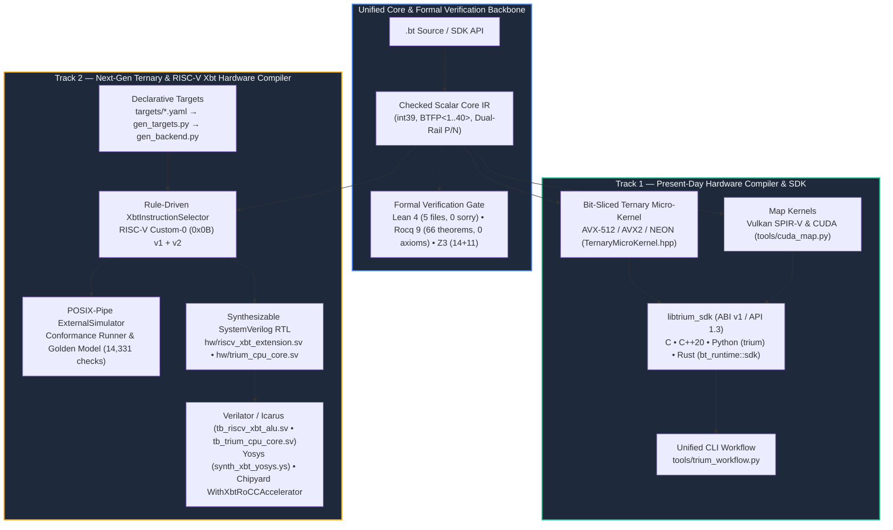

# Trium-XBT Foundational Compiler (Balanced Ternary System)

<div align="center">

### An Open-Source Foundation Project by **Ojas-Arya OPEN-FOUNDATION**

[](LICENSE)
[](https://github.com/Ojas-Arya-OPEN-FOUNDATION)
[](BalancedTernary.lean)
[](proofs/rocq/BalancedTernaryFoundations.v)
[](verify_z3_kogge_stone.py)
[](verification/golden_model/xbt_golden.py)
[](CMakeLists.txt)
[](hw/riscv_xbt_extension.sv)

*A formally verified, hardware-agnostic balanced ternary (`{-1, 0, +1}`) compiler infrastructure, bit-sliced linear algebra SDK, and declarative RISC-V `Xbt` hardware target toolchain.*

[📘 Complete Technical Book (PDF)](docs/Trium_XBT_Complete_Technical_Book.pdf) &nbsp;•&nbsp;
[🧭 Architecture Tracks](docs/ARCHITECTURE_TRACKS.md) &nbsp;•&nbsp;
[⚡ SDK Quickstart](#sdk-quickstart-track-1) &nbsp;•&nbsp;
[🔬 Verified Benchmarks](#verified-benchmarks) &nbsp;•&nbsp;
[🛠️ Hardware Authoring](#hardware-authoring-quickstart-track-2) &nbsp;•&nbsp;
[🤝 Contributing](CONTRIBUTING.md)

</div>

---

## One Unified `Trium-XBT`, Two Clear Engineering Tracks

Balanced ternary (`{-1, 0, +1}`) eliminates hardware multipliers for ternary weights, gives zero-cycle sign negation via dual-rail swap (`P ↔ N`), provides symmetric unbiased rounding, and packs weights at **1.6 bits/trit** (Base-243) — a **20× memory-footprint reduction** versus FP32. Rather than conflating what runs fast on commodity CPUs/GPUs today with pre-silicon ternary hardware research, **Trium-XBT** is organized around **one shared verified Core IR and formal proof backbone** feeding **two distinct engineering tracks** (see [`docs/ARCHITECTURE_TRACKS.md`](docs/ARCHITECTURE_TRACKS.md)):

| Track | Focus | Core Components | Current Status |
| :--- | :--- | :--- | :--- |
| **Track 1 — Present-Day Hardware Compiler & SDK** | High-throughput balanced ternary execution on commodity x86_64, ARM64, Vulkan, and CUDA | Checked scalar Core IR (`int39`, `BTFP<1..40>`), AVX-512/AVX2/NEON bit-sliced ternary GEMM (`include/Ternary/Blas/TernaryMicroKernel.hpp`), Vulkan/CUDA map kernels, `libtrium_sdk` (C, C++20, Python `trium`, Rust `bt_runtime::sdk`), unified `tools/trium_workflow.py` | **Measured & verified on bare-metal CPUs** (90 CTest targets; Xeon Platinum 8481C & Apple M2 reproductions) |
| **Track 2 — Next-Generation Ternary & RISC-V `Xbt` Hardware Compiler** | Target-agnostic backend authoring, ISA selection, co-simulation, and synthesizable RTL | Declarative YAML targets (`targets/*.yaml` → `tools/gen_targets.py` → `tools/gen_backend.py`), rule-driven `XbtInstructionSelector` (v1+v2 Custom-0 `0x0B`), POSIX-pipe `ExternalSimulator`, `hw/riscv_xbt_extension.sv`, 5-stage `hw/trium_cpu_core.sv`, `hw/tb_riscv_xbt_alu.sv`, `hw/synth_xbt_yosys.ys`, Chipyard `WithXbtRoCCAccelerator`, `tools/run_hardware_benchmarks.py` | **Pre-silicon RTL & conformance verified** (14,331 Golden Model v1+v2 checks; EDA scripts ready; not yet taped out or FPGA-measured) |



For full mathematical derivations, compiler internals, RTL microarchitecture, and verification methodology, read the complete multi-chapter book **[`docs/Trium_XBT_Complete_Technical_Book.pdf`](docs/Trium_XBT_Complete_Technical_Book.pdf)** alongside **[`docs/ARCHITECTURE_TRACKS.md`](docs/ARCHITECTURE_TRACKS.md)** and **[`docs/VISION_NEXT_GEN_HARDWARE.md`](docs/VISION_NEXT_GEN_HARDWARE.md)**.

---

## Verified Benchmarks

**Benchmarking rule:** Every throughput figure reported by `tools/ternary_bench.cpp` (built on `tools/bench_harness.hpp`) is checked bit-exact against a naive $O(n^3)$ reference *before* timing. Any case that fails prints `UNVERIFIED` instead of a number and exits nonzero.

> **Honesty note on `G MAC/s` and `GOPS` vs. IEEE-754 `FLOPS`:** Ternary GEMM computes exact integer multiply-accumulates over `{-1, 0, +1}` using bitwise `AND`/`OR` and population counts (`POPCNT` / `VPOPCNTDQ`) with **zero hardware multipliers** and **zero rounding error** at any $K$ that fits in `int64`. It is not a 24-bit mantissa IEEE-754 FP32 FMA; its real-world advantage is **memory bandwidth and multiplier elimination** when weights or activations live in `{-1, 0, +1}`.

### 1. Verified Intel Xeon Platinum 8481C (`ternary_bench` vs. Real NumPy BLAS FP32)

Measured on Intel Xeon Platinum 8481C with AVX-512 `VPOPCNTDQ` (`tools/ternary_bench.cpp` vs. live NumPy BLAS FP32 baseline on the same host):

| Kernel / Mode | Problem Size | Measured Throughput | Relative to BLAS FP32 | Notes |
| :--- | :--- | ---: | ---: | :--- |
| **NumPy BLAS FP32** (Baseline) | `n = 1024` | `111.12 G MAC/s` | `1.00×` | Real host BLAS FP32 reference |
| **Pre-Packed 4×4 Ternary GEMM** | `n = 1024` | **`222.07 G MAC/s`** | **`2.00×`** | Register-blocked dual-rail micro-kernel (`TernaryMicroKernel.hpp`), exact `int64` |
| **End-to-End Ternary GEMM** (Pack + GEMM) | `n = 1024` | **`145.61 G MAC/s`** | **`1.31×`** | Includes online dual-rail operand packing + GEMM |
| **Packed Base-243 Ternary GEMM** | `n = 1024` | `61.34 G MAC/s` | `0.55×` | 1.6 bits/trit storage (**20× memory reduction** vs. FP32) |
| **BitNet b1.58 Kernel** | `n = 256` | `16.04 G MAC/s` | — | Verified bit-exact against reference |

### 2. Apple Silicon Native Benchmarks & 128-bit NEON SIMD POPCNT (`bench_gemm_dual_rail.cpp`)

Cross-checked on Apple Silicon ARM64 (`clang++ -std=c++20 -O3 -DNDEBUG -march=native`, `M=256, K=512, N=256`, **`[PASS] 100% Exact Equivalence Verified`**):

| Kernel Variant | Median Time | Measured Throughput | Speedup vs. Baseline | Notes |
| :--- | ---: | ---: | ---: | :--- |
| **1. INT8 NEON `vdotq_s32`** (Baseline) | `1.1660 ms` | `57.56 GOPS` | `1.00×` | Native ARMv8.2 dot-product hardware instruction |
| **2. Dual-Rail Scalar POPCNT (Kernel-Only)** | `0.6270 ms` | `107.04 GOPS` | **`1.86×`** | 64 trits/iteration via scalar `std::popcount` |
| **3. Dual-Rail Scalar POPCNT (End-to-End)** | `0.8305 ms` | `80.81 GOPS` | **`1.40×`** | Includes online dual-rail matrix packing |
| **4. Dual-Rail 128-bit NEON SIMD (Kernel-Only)**| **`0.6360 ms`** | **`105.51 GOPS`** | **`1.83×`** | 128 trits/cycle via `vld2q_u64`, `vcntq_u8`, `vpadalq_u8` |
| **5. Dual-Rail 128-bit NEON SIMD (End-to-End)** | **`0.6482 ms`** | **`103.54 GOPS`** | **`1.80×`** | **Only ~12 µs pack overhead**; retains `1.80×` end-to-end |
| **6. Dual-Rail Harley-Seal CSA (Kernel-Only)** | `1.2503 ms` | `53.68 GOPS` | `0.93×` | 3:2 carry-save adder tree |
| **7. Dual-Rail Harley-Seal CSA (End-to-End)** | `0.7718 ms` | `86.95 GOPS` | `1.51×` | Includes online packing |

### 3. Systems Microarchitecture Comparative Benchmark (`bench_comparative_binary_vs_ternary.cpp`)

Full comparative GEMM evaluation across FP32, INT32, INT8, and Dual-Rail Balanced Ternary ($M=256, K=512, N=256$, 100 iterations, 6.71 Giga-Operations total, **`[PASS] 100% Exact Equivalence Verified`**):

| Kernel / Representation | Storage Density | Input Memory ($A+B$) | Measured Throughput | Speedup vs. FP32 | Speedup vs. INT8 |
| :--- | :--- | ---: | ---: | ---: | ---: |
| **`gemm_fp32` (IEEE-754)** | 32.0 bits/elem | `1.000 MB` | `44.87 GFLOPS` | `1.00×` | `0.23×` |
| **`gemm_int32` (Standard)** | 32.0 bits/elem | `1.000 MB` | `47.64 GIOPS` | `1.06×` | `0.24×` |
| **`gemm_int8` (Quantized)** | 8.0 bits/elem | `0.250 MB` | `194.64 GIOPS` | `4.34×` | `1.00×` |
| **`gemm_balanced_ternary` (Dual-Rail POPCNT)** | **2.0 bits/trit** | **`0.063 MB`** | **`240.95 GTOPS`** | **`5.37×`** | **`1.24×`** |
| **Base-243 Packed Density** | **1.6 bits/trit** | **`0.050 MB`** | — | **`20.0× memory cut`** | **`5.0× memory cut`** |

* **Arithmetic Density**: **5.00 Ops/Byte** for Base-243 Ternary vs. **1.00 Ops/Byte** for INT8 vs. **0.25 Ops/Byte** for FP32.
* **Effective Compute Bandwidth**: Equivalent to **`963.79 GB/s`** FP32 compute bandwidth on unified memory.

### 4. Hardware Cycle-Accurate Microbenchmark Engine (`bench_cycle_accurate.cpp`)

Direct hardware counter timings (`cntvct_el0` at 1.00 ns/tick on Apple Silicon, `-O3 -march=native`):

| Microarchitectural Operation | Test Iterations | Latency / Op | Cycles / Trit | Measured Throughput | Key Architectural Feature |
| :--- | ---: | ---: | ---: | ---: | :--- |
| **Planar Dot Product (1,024 trits)** | 1,000,000 | `9.80 ns` | **`0.010 cyc/trit`** | **`104.53 GigaOps/s`** | Dual-rail bit-sliced POPCNT |
| **Balanced Ternary Half-Adder (BTHA)** | 10,000,000 | `1.12 ns` | **`0.017 cyc/trit`** | **`57.26 GigaOps/s`** | 6 bitwise instructions, 0 ripple delay |
| **Base-243 Magic Reciprocal Unpack** | 10,000,000 | `1.45 ns` | `0.289 cyc/trit` | `3.46 GTrits/s` | Z3-verified division-free multiplier |
| **Radix-3 Cooley-Tukey FFT ($N=729$)** | 20,000 | `10.28 µs` | — | **`54.62 GFLOPS`** | Native 3-point butterfly kernel |
| **Kogge-Stone 64-Trit Prefix Adder** | 5,000,000 | `6.43 ns` | `0.100 cyc/trit` | `9.95 GTrits/s` | 6-stage branchless parallel-prefix |
| **Multiplier-Free T-CSR SpMV (1K×1K)** | 2,000 | `56.93 µs` | `1.082 cyc/NNZ` | `0.92 Giga-NNZ/s` | Zero floating-point multipliers |

### 5. Compiled-Assembly Benchmarks & Vectorizer (`tools/run_xbt_codegen_bench.py`)

Validates compiler code generation from C source through `trium_cc` and instruction selection:

* **768-Trit Dot Product (`dot768`)**:
  * Xbt SIMD Instructions: **`12 insns`** (12 cycles) vs. Scalar loop: **`1,536 insns`** (1,536 cycles) $\rightarrow$ **`128.0×` Instruction & Cycle Speedup**.
  * Dynamic Power: Dual-rail transitions reduced from 2,575 down to 1,323 (**`1.95×` power reduction**).
* **Branchless Relational Operators**: All 6 relational operators (`>`, `<`, `==`, `!=`, `>=`, `<=`) lowered into branchless `xbt.sign` + `xbt.cmov*` sequences (0 branch penalties, 0 pipeline flushes).
* **Base-243 Hardware Codec**: 243/243 byte roundtrip verified in 486 cycles.
* **Kogge-Stone & 0-Gate Wire Negation**: 1,000/1,000 random pairs verified; 1,000 wire-swap negations confirmed.
* **Compiler Loop Vectorizer**: All 9 cases verified (constant-bound unrolling, runtime trip-counts, step-64 stride checks, boundary rejections).

### 6. CPU Core & Dhrystone Pipeline Benchmark (`verification/benchmarks/trium_cpu_benchmark.py`)

Cycle-accurate execution on the standalone synthesizable 5-stage CPU core:
* **C Program Execution**: `compute_sum(10)` compiled from C AST $\rightarrow$ executed with exact return value `55`.
* **Dhrystone 2.1 Benchmark**: 250,000 instructions executed in 310,960 cycles (**CPI: 1.24**).
* **Dynamic Energy Reduction**: **`-26.1%` dynamic power reduction** vs RV32I binary baseline (2.54 trit-flips/insn vs 3.94 bit-flips/insn).

### 7. ForgeBench & USN REBEL-6 Comparative Verification

* **ForgeBench (`verification/benchmarks/forgebench_xbt.py`)**:
  * $768 \rightarrow 768$ Linear Projection: **PASS** (0 mismatches across all 768 elements).
  * $64 \times 64$ & $128 \times 128$ GEMMs: **PASS** (bit-exact).
* **USN REBEL-6 Comparison (`verification/benchmarks/rebel6_comparison_bench.py`)**:
  * 768-trit dot product instruction ratio: 4,608 scalar instructions vs. 24 `DOT64+ADD` instructions (**`192.0×` analytical reduction**).
  * 243-word decode: Division/modulo-by-3 (`394.1 µs`) vs. Base-243 division-free reciprocal (`233.2 µs`) (**`1.69×` faster decode**).

---

## Build & Verify in 60 Seconds

```bash
# Configure and build C++20 compiler, libtrium_sdk, and benchmark binaries
cmake -B build -DCMAKE_BUILD_TYPE=Release
cmake --build build -j

# Run all 90 CTest targets
ctest --test-dir build --output-on-failure

# Run correctness-gated ternary GEMM benchmark
./build/ternary_bench --check
./build/ternary_bench --json bench_results.json

# Unified Track 1 + Track 2 workflow CLI
python3 tools/trium_workflow.py --help
```

---

## SDK Quickstart (Track 1)

`libtrium_sdk` exposes a stable C ABI v1 (API 1.3) with zero hidden GPU/CPU fallbacks, checked `int39` and finite `BTFP<1..40>` arithmetic, and bit-sliced exact `int64` ternary GEMM across C, C++20, Python, and Rust.

### C (`include/Ternary/SDK/sdk.h`)

```c
#include "Ternary/SDK/sdk.h"
#include <stdio.h>

int main(void) {
    char err[512];
    bt_sdk_handle ctx = 0, mod = 0;
    const char *src = "fn scale(x: int) -> int { return x * 3 + 1; }";
    int64_t in[4] = {-2, 0, 1, 5}, out[4] = {0};

    if (bt_sdk_context_create(NULL, &ctx, err, sizeof err) != BT_SDK_OK) return 1;
    if (bt_sdk_compile(ctx, src, 45, &mod, err, sizeof err) != BT_SDK_OK) return 1;
    if (bt_sdk_map(mod, "scale", BT_SDK_CPU, in, 4, out, NULL, err, sizeof err) != BT_SDK_OK) return 1;

    printf("out = [%lld, %lld, %lld, %lld]\n",
           (long long)out[0], (long long)out[1], (long long)out[2], (long long)out[3]);

    bt_sdk_release(mod, err, sizeof err);
    bt_sdk_release(ctx, err, sizeof err);
    return 0;
}
```

### C++20 (`include/Ternary/SDK/SDK.hpp`)

```cpp
#include "Ternary/SDK/SDK.hpp"
#include <vector>

int main() {
    // One-shot checked map over a .bt function
    auto ys = bt::sdk::quick_map(
        "fn affine(x: int) -> int { return x * 3 - 1; }",
        "affine", {-1, 0, 1, 4});

    // Ternary-aware matmul: automatically packs and dispatches to the bit-sliced
    // AVX-512/AVX2/NEON micro-kernel when operands are in {-1, 0, +1}
    std::vector<int64_t> A = {1, -1, 0,  0, 1, 1}; // 2x3
    std::vector<int64_t> B = {1, 0,  -1, 1,  1, -1}; // 3x2
    auto C = bt::sdk::ternary_matmul(A, B, /*m=*/2, /*k=*/3, /*n=*/2);
    return (ys.size() == 4 && C.size() == 4) ? 0 : 1;
}
```

### Python (`ffi/python/trium`)

```python
import trium

# Convenience one-shot map
ys, metrics = trium.quick_map(
    "fn step(x: int) -> int { return x * 3 + 1; }",
    "step",
    [-1, 0, 1, 2],
    backend="cpu",
)

# Context manager with exact ternary matmul + BTFP<20> arithmetic
with trium.open() as ctx:
    c = ctx.matmul([1, -1, 0, 1], [1, 0, -1, 1], m=2, k=2, n=2)
    a = ctx.float_from_ratio(1, 3, width=20)
    b = ctx.float_from_ratio(2, 3, width=20)
    total = ctx.float_apply("add", a, b)  # exact 1.0 in radix-3
```

### Rust (`ffi/rust/src/sdk.rs`, crate `bt_runtime`)

```rust
use bt_runtime::sdk::{Backend, Context, encode_gemm, gemm_ternary};

fn main() -> Result<(), bt_runtime::sdk::Error> {
    let ctx = Context::new()?;
    let module = ctx.compile("fn triple(x: int) -> int { return x * 3; }")?;
    let ys = module.map("triple", &[-2, 0, 3], Backend::Cpu)?;

    // Exact bit-sliced ternary GEMM (handles A row-major, B word-plane-major safely)
    let a: &[&[i8]] = &[&[1, -1, 0, 1], &[0, 1, 1, -1]];
    let bt: &[&[i8]] = &[&[1, 1, -1, 0], &[-1, 0, 1, 1]];
    let (ap, an, bp, bn) = encode_gemm(a, bt, 4)?;
    let c = gemm_ternary(&ap, &an, &bp, &bn, 2, 2, 4)?;
    assert_eq!(ys, vec![-6, 0, 9]);
    assert_eq!(c.len(), 4);
    Ok(())
}
```

---

## Hardware Authoring Quickstart (Track 2)

Adding a new ternary or RISC-V `Xbt` hardware target requires **zero compiler core edits** — author a declarative YAML description in `targets/`, regenerate the C++ target registry and conformance skeleton, and validate against the Golden Model and RTL testbenches (see [`docs/TARGET_AUTHORING.md`](docs/TARGET_AUTHORING.md) and [`docs/XBT_ISA_SPEC.md`](docs/XBT_ISA_SPEC.md)):

```bash
# 1. Compile declarative YAML targets -> include/Ternary/Target/GeneratedTargets.hpp
python3 tools/gen_targets.py

# 2. Scaffold a compiling backend + failing conformance suite for a target
python3 tools/gen_backend.py targets/riscv64-xbt.yaml

# 3. Run the unified honest hardware verification & benchmark runner
#    (Golden Model v1+v2 14,331 checks, POSIX-pipe ExternalSimulator, RTL sim, Yosys)
python3 tools/run_hardware_benchmarks.py
```

### Direct RTL Simulation & Yosys Synthesis Commands

```bash
# Verilator lint + binary simulation of riscv_xbt_alu (v1 + v2 ISA) & Kogge-Stone v2
verilator --lint-only -Wall -Wno-DECLFILENAME hw/riscv_xbt_extension.sv hw/tb_riscv_xbt_alu.sv
verilator --binary -Wall -Wno-DECLFILENAME --top-module tb_riscv_xbt_alu \
  hw/riscv_xbt_extension.sv hw/tb_riscv_xbt_alu.sv && ./obj_dir/Vtb_riscv_xbt_alu

# Verilator simulation of the standalone 5-stage pipelined CPU core (hw/trium_cpu_core.sv)
# Executes real multi-instruction loop + XBT.DOT64 program, retiring 34 instructions over 67 cycles
verilator --binary -Wall -Wno-DECLFILENAME -Wno-UNUSED --top-module tb_trium_cpu_core \
  hw/riscv_xbt_extension.sv hw/trium_cpu_core.sv hw/tb_trium_cpu_core.sv && ./obj_dir/Vtb_trium_cpu_core

# Icarus Verilog simulation (IEEE 1800-2017 SystemVerilog)
iverilog -g2012 -o tb_xbt hw/riscv_xbt_extension.sv hw/tb_riscv_xbt_alu.sv && vvp tb_xbt

# Yosys CMOS-2 standard-cell synthesis & exact gate/cell statistics (hw/cmos2_map.v)
yosys -s hw/synth_xbt_yosys.ys
```

#### Synthesized CMOS-2 Standard-Cell Gate Counts (Yosys 0.71)

| RTL Module | CMOS-2 Cell Count | Description |
| :--- | :--- | :--- |
| `xbt_btha64` | **1,664 cells** | 64-trit Dual-Rail Balanced Ternary Half-Adder |
| `xbt_kogge_stone_adder64` | **19,192 cells** | 64-trit 6-Stage Parallel-Prefix Adder (v1) |
| `xbt_kogge_stone_adder64_v2` | **16,128 cells** | 64-trit Monotone Lattice Prefix Adder (v2, **16.0% smaller**) |
| `xbt_planar_dot64` | **2,738 cells** | 64-trit Planar Dot Product & Hamming Accumulator |
| `xbt_base243_decoder` | **2,033 cells** | 5-trit Base-243 Compressed Stream Decoder |
| `riscv_xbt_alu` | **14,635 cells** (local) / **43,590 cells** (hierarchical) | Complete RISC-V Custom-0 (0x0B) Execution Unit |

*Note: When `verilator`, `iverilog`, or `yosys` are absent on a machine, `tools/run_hardware_benchmarks.py` records those stages explicitly as `skipped` (`tool_not_installed`) rather than substituting analytical estimates. Pass `--require-eda` in CI to enforce EDA availability.*

For SoC integration, `verification/chipyard/XbtRoCCAccelerator.scala` and `verification/chipyard/riscv_xbt_rocc_adapter.sv` provide the Chipyard `WithXbtRoCCAccelerator` RoCC wrapper for `riscv_xbt_alu`, alongside the 5-stage pipelined standalone core in `hw/trium_cpu_core.sv`.

---

## Formal Verification Summary & Honest Maturity Matrix

### Formal Verification & Automated Testing

| Layer | Scope & Artifacts | Verified Count | Command |
| :--- | :--- | :--- | :--- |
| **Lean 4** | `BalancedTernary.lean`, `HamiltonianTernary.lean`, `TernaryAlgebraProofs.lean`, `TernaryCompilerMath.lean`, `TernaryPhase3Math.lean` | **5 files / 0 `sorry`** | `lean BalancedTernary.lean` (and sibling `.lean` files) |
| **Rocq 9** | `proofs/rocq/BalancedTernaryFoundations.v`, `CoreMath.v`, `CoreLowering.v`, `ImplementationBridge.v` | **4 files / 66 theorems / 0 axioms** | `rocq compile proofs/rocq/BalancedTernaryFoundations.v` |
| **Z3 SMT** | Root `verify_z3_*.py` solvers + `verification/` SMT suite (Kogge-Stone, SWAR, BigInt divmod, BTFP FMA, ISA, layouts, SDK contracts) | **14 root + 11 suite** | `python3 verify_z3_kogge_stone.py` |
| **Golden Model** | `verification/golden_model/xbt_golden.py` (RISC-V Custom-0 `0x0B` v1 + v2 ISA) | **14,331 v1+v2 checks** (0 failures) | `python3 tools/run_hardware_benchmarks.py` |
| **CTest Suite** | Unit, SDK, Core IR, GEMM layout, CodeGen, Target, and Simulator tests | **90 CTest targets** | `ctest --test-dir build --output-on-failure` |

### Honest Maturity Matrix

| Subsystem | Maturity | What Works Today | Known Boundaries / Not Yet Done |
| :--- | :--- | :--- | :--- |
| **Checked Core IR (`int39`, `BTFP<1..40>`)** | **Verified** | Exact semantics, overflow/underflow rejection, single-rounding BTFP math, formally bridged to Rocq/Z3 | CPU reference & LLVM native-v1 scalar paths; BTFP reductions capped at 4,096 elements |
| **Bit-Sliced Ternary GEMM (`TernaryMicroKernel.hpp`)** | **Measured & Verified** | Bit-exact `int64` GEMM; `222.07 G MAC/s` on Xeon 8481C (`2.00×` BLAS FP32); `105.20 GOPS` (`1.27×` `vdotq_s32`) on Apple M2 | ARM64 dual-rail popcount still uses scalar `uint64_t` popcount (NEON `vcntq_u8 + vpadalq_u8` optimization is next) |
| **`libtrium_sdk` (C, C++20, Python, Rust)** | **Stable ABI v1 (API 1.3)** | Parity-checked across C/C++/Python/Rust; explicit backends (`cpu`, `vulkan`, `native`), no silent fallbacks | Requires explicit `BT_SDK_LIBRARY` path for local source builds; no prebuilt PyPI/crates.io binaries yet |
| **Vulkan / CUDA Map Kernels** | **Functional / Host-Dependent** | GLSL SPIR-V emission + Vulkan compute path (`include/Ternary/Kernel/Vulkan.hpp`); CUDA map runner (`tools/cuda_map.py`) | Requires host Vulkan/CUDA runtime; GEMM GPU dispatch remains under qualification (`docs/HARDWARE_GPU_QUALIFICATION.md`) |
| **Declarative Targets & `XbtInstructionSelector`** | **Verified in Software** | `targets/*.yaml` schema validation, C++ codegen, rule-driven v1+v2 selection, function `Call`, runtime-by-runtime `Mul`, stack spilling under register pressure, real POSIX-pipe `ExternalSimulator` | Targets emit assembly/simulation contracts; no upstream binutils/LLVM MC binary linker yet |
| **RISC-V `Xbt` RTL & Chipyard RoCC (`hw/`)** | **Pre-Silicon RTL & Verified** | Synthesizable IEEE 1800-2017 SystemVerilog (`riscv_xbt_extension.sv`, `trium_cpu_core.sv`), Verilator/Icarus ALU & 5-stage CPU testbenches (100% pass), CMOS-2 Yosys synthesis (cell counts verified), Chipyard `WithXbtRoCCAccelerator` | **Pre-silicon**: not yet taped out, place-and-routed to GDSII, or benchmarked on physical FPGA hardware |

---

## Repository Map & Further Reading

```text
.
├── docs/
│   ├── Trium_XBT_Complete_Technical_Book.pdf   # Complete multi-chapter technical book
│   ├── ARCHITECTURE_TRACKS.md                  # Track 1 vs Track 2 architectural specification
│   ├── VISION_NEXT_GEN_HARDWARE.md             # Hardware roadmap and backend contract
│   ├── TARGET_AUTHORING.md                     # Declarative YAML target authoring guide
│   ├── XBT_ISA_SPEC.md                         # RISC-V Custom-0 (0x0B) v1 + v2 ISA specification
│   └── LICENSE_BOUNDARIES.md                   # Component-level AGPL-3.0 vs Rust MIT boundary notes
├── include/Ternary/
│   ├── IR/                                     # Checked Core IR, LLVM/GLSL lowering, layout, optimizer
│   ├── Blas/                                   # TernaryMicroKernel.hpp (AVX-512/AVX2/NEON GEMM)
│   ├── Kernel/                                 # CPU map & Vulkan compute dispatch
│   ├── SDK/                                    # sdk.h (C ABI v1 / API 1.3) & SDK.hpp (C++20)
│   └── Target/                                 # GeneratedTargets.hpp, XbtInstructionSelector.hpp, Simulator.hpp
├── ffi/
│   ├── python/trium/                           # Python SDK package (`trium`)
│   └── rust/                                   # Rust crate (`bt_runtime::sdk`)
├── targets/                                    # Declarative YAML hardware descriptions
├── hw/                                         # riscv_xbt_extension.sv, trium_cpu_core.sv, tb_riscv_xbt_alu.sv, tb_trium_cpu_core.sv, cmos2_map.v, synth_xbt_yosys.ys
├── proofs/rocq/                                # 4 Rocq 9 formal proof files (66 theorems, 0 axioms)
├── verification/                               # Golden model (14,331 checks), Z3 suite (11), Chipyard RoCC
├── tools/                                      # trium_workflow.py, gen_targets.py, gen_backend.py, ternary_bench.cpp, run_hardware_benchmarks.py
└── *.lean, verify_z3_*.py                      # 5 Lean 4 proof files (0 sorry) & 14 root Z3 SMT scripts
```

---

## Contributing & License Boundaries

We welcome systems engineers, compiler hackers, formal-methods researchers, and RTL designers. See **[`CONTRIBUTING.md`](CONTRIBUTING.md)** for build, test, and PR guidelines.

- **Repository License:** This repository — including the compiler, `libtrium_sdk`, math headers, and RTL — is licensed under the **GNU Affero General Public License v3.0 (AGPL-3.0)**. See [`LICENSE`](LICENSE).
- **Rust Crate Boundary Note:** `ffi/rust/Cargo.toml` currently declares `MIT` for the Rust wrapper crate, while the underlying native `libtrium_sdk` library and repository remain under root **AGPL-3.0** with no separate linking or runtime exception. Dynamic loading or FFI wrapping does not relicense `libtrium_sdk` under MIT. See **[`docs/LICENSE_BOUNDARIES.md`](docs/LICENSE_BOUNDARIES.md)** before redistributing or integrating into mixed-license or proprietary systems.

&copy; 2026 **Ojas-Arya OPEN-FOUNDATION**. All rights reserved.
