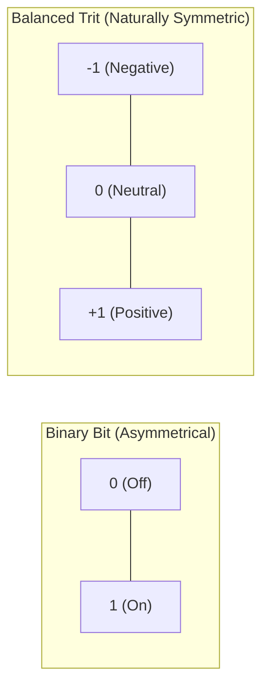
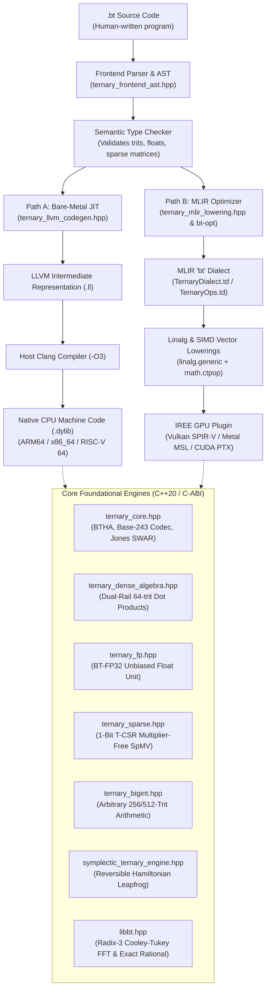

# Chapter 0: Welcome to the Trium-XBT Foundational Compiler

Hello and welcome! If you are holding or reading this document, you are about to explore one of the most exciting, unconventional frontiers in modern computing: **Balanced Ternary Computing**.

Whether you are 18 years old, a first-year student opening a code editor for the very first time, a seasoned software engineer curious about radical architectures, or someone who simply loves deep mathematics and physical simulation—**this guide was written specifically for you.**

You do **not** need a PhD in computer science. You do not need to already know what a compiler or an LLVM intermediate representation is. Every single concept—from what a "bit" and "trit" are, to how silicon processors execute math, to how a compiler turns text into electricity—will be explained step by step, using everyday analogies, visual diagrams, and worked examples done by hand.

---

## 1. What Is This Project in One Sentence?

> **The Trium-XBT Foundational Compiler is a complete, hardware-agnostic compiler and numerical computing engine that allows everyday computers (like your MacBook, PC, or server) to compute using base-3 balanced numbers (`-1, 0, +1`) at speeds faster than standard binary 32-bit floating-point arithmetic.**

---

## 2. Why Does This Project Exist? (The Big Problem with Binary)

Every computer in the world today—your smartphone, laptop, supercomputers, and cloud data centers—thinks in **binary**. Binary means "base 2", meaning everything is built out of **bits** that can only be `0` or `1`.

Imagine a light switch:
- `0` means the light is OFF.
- `1` means the light is ON.

This switch-based thinking was brilliant in the 1940s and 1950s because it was physically easy to build an electrical switch (a transistor) that was either conducting electricity or not.

### The Catch: Binary is Clumsy with Negative Numbers and Fractions
Binary has major hidden flaws that computer engineers have struggled with for 70 years:
1. **No Natural Minus Sign**: A bit can only be `0` or `1`. There is no "$-1$ bit". To represent a negative number like $-5$, binary computers have to invent complex tricks (like "Two's Complement" or dedicated sign bits). When you add positive and negative binary numbers, your computer has to do extra logic, check sign bits, and deal with two different kinds of zero ($+0$ and $-0$ in floating-point!).
2. **Rounding Drift**: In binary, fractions like $\frac{1}{3}$ or $\frac{1}{10}$ cannot be represented cleanly. When binary computers round numbers off, they truncate towards zero or positive infinity. Over billions of calculations in physics or engineering simulations, this creates a constant "drift" (like a car with bad wheel alignment that keeps pulling to the right).
3. **Silicon Wasted on Multipliers**: In binary, multiplying numbers requires huge silicon arrays of adder circuits (called Wallace trees) that consume thousands of transistors and generate heat.

### The Solution: Balanced Ternary
What if, instead of two choices (`0` and `1`), your basic unit of information had **three balanced choices** centered around zero?
- $-1$ (Negative / Pull back)
- $0$ (Neutral / Rest)
- $+1$ (Positive / Push forward)

We call a 3-way digit a **Trit** (Ternary Digit). And because it is symmetric around zero ($-1, 0, +1$), we call it **Balanced Ternary**.

In balanced ternary:
- **Negating any number takes ZERO calculation**: To turn $+5$ into $-5$, you literally just flip every $+1$ to $-1$, and every $-1$ to $+1$. Zero arithmetic. No sign bits.
- **Rounding has ZERO bias**: Discarding fractional trits has an exact mathematical average error of **$0.000000$**. It never drifts left or right!
- **Multiplication is Multiplier-Free**: Multiplying by $+1, 0, -1$ requires **zero hardware multiplier gates**. It is simply a sign flip or a zero mask.

---

## 3. The 70-Year Mystery: If Ternary Is So Great, Why Doesn't Everyone Use It?

Computer scientists have known balanced ternary was mathematically superior since Donald Knuth praised it in the 1960s. So why aren't all computers ternary?

Because the world's computer factories spent trillions of dollars perfecting binary chips. If you tried to run balanced ternary on a binary computer, you had to write slow software loops with `if (trit == -1)` statements. Modern processors hate unpredictable `if` statements—they cause pipeline stalls. Historically, simulating ternary on binary chips was **10x to 100x slower** than native binary code.

**That is the mystery this project solves.**

Using mathematical techniques called **Dual-Rail Bit-Slicing** and **Hardware Population Counts (`POPCNT`)**, this compiler organizes ternary math so that a binary computer executes 64 ternary calculations simultaneously using native single-cycle bitwise instructions.

The result? On a standard laptop, our ternary dot product executes in **$9.87 \text{ nanoseconds}$** for 1024 values—which is **6x to 9x faster than native binary single-precision float math on the exact same CPU**!

---

## 4. System Bird's-Eye View

Here is how all the pieces of this project fit together, from human code to raw silicon:

---

## 5. Plain-Language Glossary

Before we go any further, here are the terms you will see in this guide, explained in simple human language:

| Term | Everyday Analogy | Technical Definition |
| :--- | :--- | :--- |
| **Bit** | A light switch: either `0` (OFF) or `1` (ON). | Binary digit (base 2). |
| **Trit** | A 3-position lever: `-1` (Down), `0` (Middle), `+1` (Up). | Ternary digit (base 3). |
| **Radix** | The number of fingers you count on (base 10 = decimal, base 2 = binary, base 3 = ternary). | The base of a positional numbering system. |
| **Register** | A tiny scratchpad right on the CPU chip where it holds numbers it is working on right this millisecond. | Fast, fixed-size on-chip storage (e.g. 64-bit integer register). |
| **Compiler** | A master translator that turns human-readable text code into raw machine instructions. | Software translating high-level source code to lower-level machine code. |
| **AST (Abstract Syntax Tree)** | A family-tree diagram representing the sentences and grammar of your program. | Tree representation of the abstract syntactic structure of source code. |
| **IR (Intermediate Representation)** | A universal "Esperanto" language halfway between human code and raw machine assembly. | Machine-independent code representation used by modern compilers (e.g. LLVM IR). |
| **LLVM** | The world's most powerful compiler engine, used by Apple, Google, Rust, and Clang to generate lightning-fast machine code. | An industry-standard modular compiler infrastructure framework. |
| **MLIR** | "Multi-Level IR"—a modern extension of LLVM that allows compilers to invent custom mathematical dialects. | Multi-Level Intermediate Representation for domain-specific compilers. |
| **JIT (Just-In-Time)** | Translating code into machine instructions right as the program is about to run, rather than weeks beforehand. | Dynamic compilation during runtime execution. |
| **SIMD** | "Single Instruction, Multiple Data"—like an army drill sergeant shouting one command that 1,000 soldiers obey at once. | CPU/GPU instructions that apply the same operation across parallel data lanes simultaneously. |
| **POPCNT (Population Count)** | Counting how many marbles are in a bag in one glance, without counting one by one. | Hardware CPU instruction that returns the number of set bits (`1`s) in a word in 1 clock cycle. |
| **Dual-Rail Plane** | Using two sheets of tracing paper (one for positive, one for negative) instead of trying to draw 3 colors on one sheet. | Storing a ternary vector as two separate binary bitmasks: a positive mask $P$ and negative mask $N$. |
| **Sanitizers (ASan/UBSan)** | High-tech metal detectors and safety inspectors that watch your code run and sound an alarm if any memory leak or illegal math occurs. | Compiler runtime instrumentation (`compiler-rt`) checking AddressSanitizer and UndefinedBehaviorSanitizer rules. |
| **FFI (Foreign Function Interface)** | A universal diplomatic passport that lets Python, Rust, or C code talk to our ternary engine without friction. | A mechanism allowing a program in one language to call subroutines in another language. |

---

## 6. How to Read This Guide

This documentation is divided into 9 progressive chapters:
1. **Chapter 1: Number Systems From Zero**: How numbers work, why binary won, why balanced ternary is beautiful, and how to convert numbers by hand.
2. **Chapter 2: The Core Engineering Tricks**: Dual-rail bitplanes, multiplier-free dot products, 6-instruction half-adders, magic reciprocal Base-243 unpackers, and Douglas Jones SWAR trees.
3. **Chapter 3: Repository Map**: A guided walking tour of every directory and file in the codebase.
4. **Chapter 4: The Compiler Deep Dive**: How a `.bt` program travels from lexer to AST to LLVM IR to native Clang JIT execution.
5. **Chapter 5: Numerics, Memory & Physics**: BT-FP32 floats, 1-bit sparse algebra (T-CSR), Radix-3 Cooley-Tukey FFTs, and reversible symplectic phase-space engines.
6. **Chapter 6: MLIR, GPUs & Multi-Language Bindings**: Dialect TableGen, `bt-opt`, IREE GPU plugins (Metal/Vulkan/CUDA), Rust crates, and Python ctypes.
7. **Chapter 7: Rebuilding This Project from Scratch**: A 12-milestone step-by-step blueprint so anyone with a C++ compiler can build this entire system from blank files.
8. **Chapter 8: Honest Report Card & Next Steps**: Real measured benchmarks, what GTOPS means vs FLOPS, limitations, and future frontiers.

---

### Check Yourself!
1. What does the word "balanced" mean in "balanced ternary"?
2. What are the three values a trit can take?
3. Why does negating a balanced ternary number cost zero arithmetic operations?
4. What is a "register" on a CPU chip?

*(Answers: 1. It means the digits are centered symmetrically around zero. 2. $-1, 0, +1$. 3. You just swap every $+1$ to $-1$ and vice versa; no borrowing or addition is needed. 4. A tiny, ultra-fast memory scratchpad located directly on the processor chip).*
