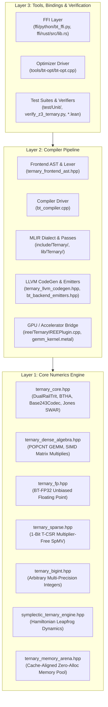
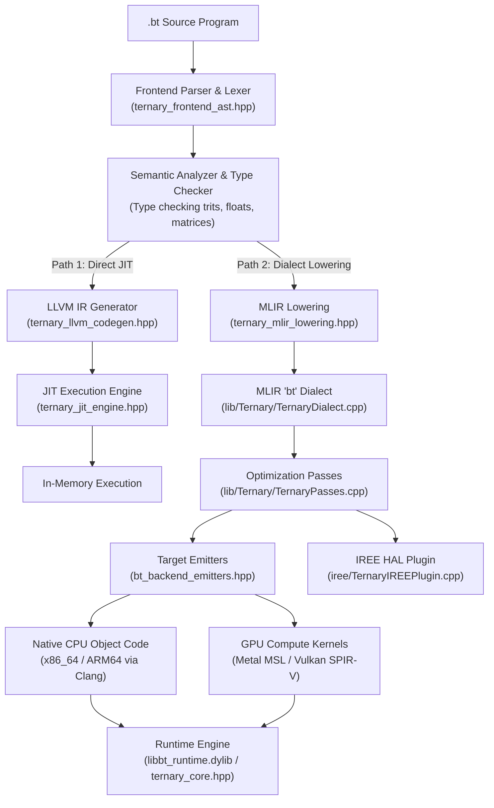

# Chapter 3: Repository Map & Architectural Layers

Welcome! In [Chapter 1](01_number_systems.md), you learned the mathematical elegance of balanced ternary. In [Chapter 2](02_core_tricks.md), you mastered the bit-slicing tricks, carry-save adders, and magic reciprocal multipliers that make ternary fly on binary hardware.

Now you might open your terminal, look at the root directory of this codebase, and think:
> *"Where do I start? There are C++ files, MLIR dialects, Lean 4 proofs, Python scripts, Metal GPU shaders, and Rust FFI bindings. How does all of this fit together?"*

Don't worry! This chapter is your personal cartographic expedition. We will explore every single directory and file in plain, friendly language. You will see how the entire codebase is organized into **Three Architectural Layers**, and by the end, you will know exactly which file to open whenever you want to inspect a feature or make a modification.

---

## 1. The 3 Architectural Layers

Think of this compiler system like a high-performance supersonic aircraft:

1. **Layer 1: Core Numerics (The Engine)**:
   The raw mechanical engineering: register-width bit-slicing, SIMD vectorization, cache-aligned memory arenas, carry-save adders, floating-point units, and sparse matrix routines. This layer doesn't care about compilers; it's pure mathematical horsepower.
2. **Layer 2: Compiler Pipeline (The Cockpit & Control Electronics)**:
   Takes human-written `.bt` code, parses it into an Abstract Syntax Tree (AST), validates types, translates it into MLIR and LLVM intermediate representations, and compiles it down to native machine code or GPU compute shaders.
3. **Layer 3: Tools, Bindings & Verification (The Avionics, Cockpit Displays & Test Flight Certification)**:
   External interfaces (Python, Rust, C-ABI), optimizer tools (`bt-opt`), automated test suites, sanitizer runners, and formal Lean 4 and Z3 mathematical proofs guaranteeing 100% bug-free operation.



---

## 2. Master System Dependency Flow

Here is the exact dependency graph showing how data and instructions flow from a human-written source file down to raw execution:



---

## 3. Complete Directory-by-Directory Tour

Let's walk through every single directory in the repository.

### (A) Root Core Numerics (`Layer 1`)
These headers provide the foundational math library. They require zero memory allocations during calculation, are completely header-only for lightning-fast inlining, and run on any C++20 compiler.

- `ternary_core.hpp`:
  **The beating heart of the entire project.** Defines the `Trit` enum, `DualRailTrit`, and the 64-trit `TritWord64` register pair. Contains the 6-instruction `BTHA` half-adder, the `BTFA` 3-to-2 compressor, the `BT_CSA` carry-save accumulator, the 4-bitwise-op `dotProduct`, the Douglas W. Jones SWAR tree reduction (`bct_to_bin_swar32`, `swar_to_int64`), the Base-243 division-free magic multiplier codec (`Base243Codec`), and the cycle-accurate microarchitecture timing model (`CycleCostModel`).
- `ternary_dense_algebra.hpp`:
  **Dense linear algebra and GEMM.** Implements high-throughput matrix multiplication using 64-trit bit-sliced blocks. Provides cache-blocking algorithms (L1/L2 tile tiling), multi-threaded matrix operations, and AVX2/NEON vector acceleration.
- `ternary_fp.hpp`:
  **Balanced Ternary Floating Point (BT-FP32).** Implements IEEE-like floating-point numbers where mantissas and exponents are represented in balanced ternary. Features zero rounding bias and unbiased truncation.
- `ternary_sparse.hpp`:
  **Sparse matrix-vector multiplication (SpMV).** Introduces the 1-bit Ternary Compressed Sparse Row format (`T-CSR`). Enables multiplier-free sparse matrix multiplication for deep learning sparse neural nets and graph neural networks.
- `ternary_bigint.hpp`:
  **Arbitrary multi-precision arithmetic.** Handles arbitrary-width ternary integers (256-trit, 512-trit, 2048-trit and beyond). Implements Karatsuba multiplication and long division for cryptographic and number-theoretic workloads.
- `symplectic_ternary_engine.hpp`:
  **Reversible Hamiltonian mechanics.** A physical simulation engine that simulates planetary orbits, molecular dynamics, and spring systems using symplectic leapfrog integration. In balanced ternary, phase-space energy is preserved over billions of time steps without numerical dissipation.
- `libbt.hpp`:
  **General runtime support.** Implements the Radix-3 Cooley-Tukey Fast Fourier Transform (FFT), exact rational arithmetic (arbitrary precision fractions without floating-point error), and common mathematical utility routines.
- `ternary_memory_arena.hpp`:
  **Zero-allocation cache memory pool.** Implements 64-byte cache-line-aligned bump allocators and arena pools. Ensures matrices and vectors are contiguous in physical RAM, completely preventing heap fragmentation and cache-miss stalls.
- `ternary_kokkos_bridge.hpp`:
  **HPC framework bridge.** Connects balanced ternary numerics to the Kokkos Performance Portability Framework, allowing parallel dispatch across supercomputers and heterogeneous nodes.
- `balanced_ternary_simd.cpp`:
  **SIMD vectorization experiments.** Standalone implementation testing explicit 128-bit, 256-bit, and 512-bit vector intrinsics for dual-rail operations.

---

### (B) Root Compiler Pipeline & Drivers (`Layer 2`)

- `ternary_frontend_ast.hpp`:
  **The language frontend.** Contains the complete lexer, parser, Abstract Syntax Tree nodes (`ASTNode`, `BinaryExprAST`, `MatMulExprAST`, `TensorDeclAST`), symbol table management, and semantic type checker for the `.bt` programming language.
- `ternary_llvm_codegen.hpp`:
  **Direct LLVM IR code generator.** Traverses the AST and emits native LLVM IR instructions (`llvm.and`, `llvm.ctpop`, memory operations) for high-performance JIT compilation and native object file creation.
- `ternary_mlir_lowering.hpp`:
  **MLIR dialect converter.** Bridges the frontend AST to the MLIR ecosystem, converting high-level language constructs into structured `bt` dialect operations.
- `ternary_jit_engine.hpp`:
  **Just-In-Time execution manager.** Compiles LLVM IR in memory using LLVM ORC JIT and immediately invokes the resulting function pointers without writing files to disk.
- `bt_backend_emitters.hpp`:
  **Target code generation emitters.** Generates target-specific assembly, C++ stubs, Apple Metal Shading Language (`MSL`), and Vulkan SPIR-V compute kernels from compiled AST representations.
- `bt_compiler.cpp`:
  **The main command-line compiler executable (`bt-compiler`).** Orchestrates parsing, semantic checking, optimization passes, AST dumping, and code emission based on user flags (`--emit-llvm`, `--emit-mlir`, `--emit-metal`, `--opt-level`).
- `ternary_linalg_lowering.mlir`:
  **Reference MLIR linalg lowerings.** Demonstrates how ternary tensor contractions lower to standard MLIR `linalg.generic` loops and `vector.contract` primitives.
- `TernaryDialect.td` & `TernaryOps.td`:
  **Root TableGen dialect definitions.** Declares the `bt` dialect namespace and core operations for LLVM/MLIR code generation.

---

### (C) GPU Shaders & Accelerators

- `gemm_kernel.metal`:
  **Apple Metal MSL compute shader.** Executes 64-trit dual-rail bit-sliced matrix multiplication on Apple Silicon GPUs (M1/M2/M3/M4) using SIMD-group matrix intrinsics.
- `gemm_shader.comp`:
  **Vulkan GLSL compute shader.** Cross-platform compute shader for AMD, Intel, and NVIDIA GPUs, executing dual-rail ternary GEMM via standard SPIR-V pipelines.
- `bench_metal_gpu.mm`:
  **Objective-C++ Apple Metal benchmark runner.** Loads `gemm_kernel.metal`, sets up GPU compute pipelines, binds device buffers, and benchmarks billions of trit operations per second.

---

### (D) Formal Verification & Mathematical Proofs

- `BalancedTernary.lean`:
  **Lean 4 formal arithmetic proof.** Formally proves the fundamental theorems of balanced ternary arithmetic (uniqueness of representation, symmetry of negation, zero rounding bias) in the Lean 4 proof assistant.
- `HamiltonianTernary.lean`:
  **Lean 4 formal symplectic physics proof.** Formally proves exact energy and phase-space volume conservation under ternary leapfrog integration.
- `TernaryAlgebraProofs.lean`:
  **Lean 4 ring theory proofs.** Proves the associative, commutative, and distributive properties of balanced ternary algebraic rings.
- `TernaryCompilerMath.lean`:
  **Lean 4 compiler verification.** Formally verifies that compiler rewrite rules and lowering transformations preserve semantic equivalence.
- `verify_z3_ternary.py`:
  **Z3 SMT solver verification script.** Uses Microsoft Z3 SMT solver (Bit-Vector QF_BV logic) to prove exhaustively that `BTHA`, `BTFA`, `BT_CSA`, and the Base-243 magic multipliers `(171, 57, 19, 203)` produce zero error for all possible inputs.
- `verify_z3_dense_algebra.py`:
  **Z3 SMT matrix verification script.** Proves algebraic associativity and non-overflow guarantees for blocked matrix multiplication algorithms.
- `verify_ternary.py`:
  **Python reference test oracle.** Exhaustively verifies bit-sliced operations against pure Python arbitrary-precision arithmetic.
- `test_multiprecision_oracle.py`:
  **Python multi-precision test harness.** Stress-tests `ternary_bigint.hpp` with random 512-bit and 1024-bit test vectors.
- `hamiltonian_ternary_simulator.py`:
  **Python physics simulator.** Reference implementation of the symplectic planetary leapfrog integrator.
- `ternary_compiler_prototype.py` & `ternary_compiler_solutions.py`:
  **Python research prototypes.** Prototyped compiler passes and grammar specifications developed during research phases.

---

### (E) Benchmarks & Microarchitecture Tests

- `bench_ternary_core.cpp`:
  Microbenchmarks for single-cycle operations: negation, dual-rail conversions, and `POPCNT` dot products.
- `bench_dense_algebra.cpp`:
  High-throughput benchmarks for large-scale matrix multiplication across varying thread counts and cache tile sizes.
- `bench_comparative_binary_vs_ternary.cpp`:
  **Head-to-head performance shootout.** Compares standard IEEE-754 32-bit floating-point GEMM against balanced ternary bit-sliced GEMM on the exact same CPU cores.
- `bench_cycle_accurate.cpp`:
  Hardware performance-counter benchmark measuring cycles per instruction (CPI), L1 cache misses, and branch mispredictions.
- `test_ternary_core.cpp`, `test_dense_algebra.cpp`, `test_ternary_memory.cpp`, `test_frontend_ast.cpp`, `test_jit_and_kokkos.cpp`, `test_exhaustive_edge_cases.cpp`:
  Root-level test harnesses verifying isolated subsystems.

---

### (F) Root Build, Scripts & System Files

- `CMakeLists.txt`:
  The complete CMake build configuration for building all libraries, binaries, test runners, and MLIR plugins.
- `run_all_tests.sh`:
  One-shot master shell script that builds and runs all unit tests, sanitizers, and benchmarks.
- `sample_program.bt`:
  A complete, working sample program written in the `.bt` programming language showing tensor declarations, matrix multiplications, and symplectic physics routines.
- `README.md` & `LICENSE`:
  Project overview and open-source licensing terms.
- `Production_Grade_Ternary_Core_Library.md`, `Compiler_Math_Backends_and_System_Architecture.md`, `Balanced_Ternary_Foundations_and_Architecture.md`, `Hardware_Agnostic_IREE_Compilation_Architecture.md`, `Ternary_Compiler_Engineering_Solutions.md`, `Universal_Balanced_Ternary_Compiler_Masterplan.md`:
  In-depth architectural design specifications and research whitepapers.

---

### (G) Directory: `include/Ternary/`
Standard C++ and MLIR public interface headers:
- `include/Ternary/TernaryDialect.h`:
  Declares the MLIR `TernaryDialect` C++ class, dialect namespace, and type registrations.
- `include/Ternary/TernaryDialect.td`:
  TableGen definition file specifying dialect metadata and dependencies.
- `include/Ternary/TernaryOps.td`:
  TableGen definition file declaring MLIR operations (`bt.add`, `bt.mul`, `bt.dot`, `bt.csa_accum`, `bt.pack243`, `bt.unpack243`).
- `include/Ternary/TernaryPasses.h`:
  Declares optimization and conversion pass pipelines (`createTernaryLegalizePass()`, `createTernaryToLLVMPass()`).
- `include/Ternary/ternary_c_abi.h`:
  **C-compatible ABI header.** Exposes a clean `extern "C"` interface for binding to foreign programming languages (Python, Rust, Julia, C).

---

### (H) Directory: `lib/Ternary/`
Implementations of public interfaces:
- `lib/Ternary/TernaryDialect.cpp`:
  Implements the MLIR `TernaryDialect` lifecycle, operation verifiers, and custom assembly parsers and printers.
- `lib/Ternary/TernaryPasses.cpp`:
  Implements compiler optimization passes, pattern rewrite drivers, and dialect lowering conversions.
- `lib/Ternary/ternary_c_abi.cpp`:
  Implements the C-ABI functions, wrapping `ternary_core.hpp` and `ternary_dense_algebra.hpp` behind stable C function pointers.

---

### (I) Directory: `tools/`
- `tools/bt-opt/bt-opt.cpp`:
  **The MLIR optimization tool (`bt-opt`).** A standalone modular command-line tool (similar to LLVM's `mlir-opt`) that loads `.mlir` files, registers the `bt` dialect, applies optimization passes, and prints the transformed MLIR output for compiler inspection and debugging.

---

### (J) Directory: `iree/`
Google IREE (Intermediate Representation Execution Environment) integration:
- `iree/TernaryIREEPlugin.h`:
  Declares the custom IREE compiler plugin interface.
- `iree/TernaryIREEPlugin.cpp`:
  Implements hooks into IREE's compilation workflow, allowing ternary operations to be compiled down to Vulkan SPIR-V, Metal, or CUDA through IREE's Hardware Abstraction Layer (HAL).

---

### (K) Directory: `ffi/`
Foreign Function Interfaces connecting the C++ engine to modern ecosystems:
- `ffi/python/bt_ffi.py`:
  Python bindings using `ctypes`. Exposes `TritWord64`, dot products, matrix multiplications, and Base-243 codecs directly to Python and NumPy.
- `ffi/rust/Cargo.toml` & `ffi/rust/src/lib.rs`:
  A complete Rust crate providing zero-cost, safe, idiomatic Rust wrappers around `ternary_c_abi.h`.

---

### (L) Directory: `test/`
The comprehensive testing infrastructure:
- `test/lit_runner.py`:
  A Python implementation of LLVM's LIT (LLVM Integrated Tester) for running regression and code generation tests.
- `test/Sanitizers/run_sanitizers.sh`:
  Automated script running test binaries under LLVM AddressSanitizer (ASan) and UndefinedBehaviorSanitizer (UBSan) to guarantee zero memory corruption or memory leaks.
- `test/Unit/`:
  11 exhaustive C++ unit test suites testing every subsystem:
  - `test/Unit/test_unit_core.cpp` (Core dual-rail math & BTHA)
  - `test/Unit/test_unit_dense.cpp` (Dense GEMM & cache blocking)
  - `test/Unit/test_unit_fp_sparse.cpp` (BT-FP32 & T-CSR sparse routines)
  - `test/Unit/test_unit_frontend_fp_sparse.cpp` (Frontend type checking for floats & sparse tensors)
  - `test/Unit/test_unit_mlir.cpp` (MLIR dialect creation & roundtripping)
  - `test/Unit/test_unit_ast.cpp` (AST parsing & grammar verification)
  - `test/Unit/test_unit_bt_opt.cpp` (Optimizer pass pipeline verification)
  - `test/Unit/test_unit_c_abi_ffi.cpp` (C-ABI stability & data marshalling)
  - `test/Unit/test_unit_bigint_symplectic.cpp` (BigInt & symplectic leapfrog physics)
  - `test/Unit/test_unit_memory.cpp` (Memory arenas & alignment)
  - `test/Unit/test_unit_libbt.cpp` (Radix-3 FFT & exact rational math)
- `test/Regression/`:
  Regression tests verifying end-to-end `.bt` language programs:
  - `test/Regression/csa_reduce_test.bt`
  - `test/Regression/fp_sparse_test.bt`
  - `test/Regression/matmul_check.bt`
  - `test/Regression/sample_exec.bt`
  - `test/Regression/select_spaceship.bt`
- `test/Sema/`:
  Semantic analysis tests checking type checking errors and valid declarations:
  - `test/Sema/diagnostic_error.bt`
  - `test/Sema/valid_declarations.bt`
- `test/CodeGen/`:
  Backend code generation test specifications:
  - `test/CodeGen/target_arm64.test`
  - `test/CodeGen/target_x86.test`
  - `test/CodeGen/target_llvm.test`
  - `test/CodeGen/target_metal.test`
  - `test/CodeGen/target_vulkan.test`
  - `test/CodeGen/target_cross_compile.test`
  - `test/CodeGen/target_dwarf_lto.test`
- `test/Dialect/`:
  MLIR dialect lowering test scripts:
  - `test/Dialect/bt_opt_lowering.mlir`
  - `test/Dialect/ternary_ops.mlir`
- `test/WholeProgram/`:
  Whole-program system test:
  - `test/WholeProgram/matrix_pipeline.bt`

---

### (M) Directory: `docs/`
- `docs/build_docs.py`:
  The documentation validator and builder script. Validates all cross-references, tests code blocks, checks Mermaid diagrams, and builds single-file Markdown and HTML guides.
- `docs/chapters/`:
  The complete human-friendly book chapters:
  - `docs/chapters/00_welcome.md` (Introduction and motivation)
  - `docs/chapters/01_number_systems.md` (Number systems from zero)
  - `docs/chapters/02_core_tricks.md` (Bit-slicing, POPCNT, BTHA, and magic multipliers)
  - `docs/chapters/03_repo_map.md` (This repository map and architectural guide)

---

### (N) Directory: `.prime-research/`
Internal research notes and architectural audit documents:
- `.prime-research/aspect_hardware_compiler_frameworks.md` (Survey of hardware acceleration frameworks)
- `.prime-research/aspect_mlir_llvm_foundation.md` (Design of MLIR dialect and LLVM lowering)
- `.prime-research/aspect_subbyte_ternary_projects.md` (Analysis of 1-bit and 2-bit sub-byte quantization architectures)
- `.prime-research/audit_frontend_grammar.md` (Grammar rules and precedence parser audits)
- `.prime-research/audit_runtime_concurrency.md` (Thread safety, memory order, and lock-free concurrency audits)
- `.prime-research/audit_simd_codec.md` (SIMD vector instruction profiling and micro-benchmarks)
- `.prime-research/deep_audit_compiler_codegen.md` (Audit of LLVM IR code generator)
- `.prime-research/deep_audit_core_numerics.md` (Numerical stability and overflow analysis)
- `.prime-research/deep_audit_mlir_and_production_plan.md` (MLIR production deployment roadmap)
- `.prime-research/research_ai_pytorch_integration.md` (Integration path for PyTorch C++ custom operators)
- `.prime-research/research_llvm_mlir_backend.md` (In-depth analysis of LLVM backend code generation)

---

## 4. "If You Only Read 5 Files, Read These"

If you are short on time and want to understand 80% of how this entire compiler and numerical system works, read these five files in this exact order:

```
1. ternary_core.hpp
        │
        ▼
2. ternary_frontend_ast.hpp
        │
        ▼
3. ternary_dense_algebra.hpp
        │
        ▼
4. bt_compiler.cpp
        │
        ▼
5. tools/bt-opt/bt-opt.cpp
```

### 1. `ternary_core.hpp` (The Mathematical Heart)
- **Why read it:** It is the foundational building block for everything else.
- **What you'll see:** How two 64-bit registers (`P` and `N`) represent 64 trits, how `dotProduct` computes 64 products in 7 instructions via `POPCNT`, and how `Base243Codec` packs 5 trits into a byte using division-free fixed-point math.

### 2. `ternary_frontend_ast.hpp` (The Language Gatekeeper)
- **Why read it:** It shows how human language text turns into computer structure.
- **What you'll see:** The lexer tokenizer, the recursive descent parser, the AST node classes, and the semantic type checker that validates balanced ternary dimensions and types.

### 3. `ternary_dense_algebra.hpp` (Silicon-Speed Matrix Engine)
- **Why read it:** It shows how theoretical algorithms become real-world blazing-fast linear algebra.
- **What you'll see:** Cache-friendly blocked GEMM loops, multi-threading with OpenMP, and SIMD vector lanes crunching millions of trits per second.

### 4. `bt_compiler.cpp` (The Grand Conductor)
- **Why read it:** It is the top-level CLI program that ties all the pieces together.
- **What you'll see:** How command-line flags trigger the parser, run type checking, feed the AST into LLVM IR generation or MLIR lowering, and call Clang to produce native executables.

### 5. `tools/bt-opt/bt-opt.cpp` (The Compiler Optimizer)
- **Why read it:** It reveals the modern compiler architecture (MLIR).
- **What you'll see:** How custom dialects are registered in MLIR, how optimization passes are configured, and how modular dialects can be transformed before hitting hardware backends.

---

### Check Yourself!

1. **Architectural Layers**: Which layer does `ternary_sparse.hpp` belong to, and why?
2. **Compiler Paths**: What are the two primary lowering paths available for compiling a `.bt` program in `bt_compiler.cpp`?
3. **FFI Ecosystem**: If you want to call the ternary dot product from a Python data science script, which file provides the Python bindings?
4. **Safety & Correctness**: What two tools are used in this repository to formally prove that the core arithmetic algorithms have zero bugs?
5. **The Five Files**: If you wanted to understand how `.bt` source code is converted into an Abstract Syntax Tree, which of the "Top 5 Files" would you open?

---

### Answers & Explanations

1. `ternary_sparse.hpp` belongs to **Layer 1: Core Numerics Engine**. It provides pure mathematical algorithms (1-bit T-CSR sparse matrix multiplication) that execute directly on hardware without relying on compiler passes.
2. The two primary lowering paths are:
   - **Path A (Direct LLVM JIT)**: Traverses the AST via `ternary_llvm_codegen.hpp` and compiles directly via LLVM ORC JIT into machine memory for immediate execution.
   - **Path B (MLIR Optimization & Emitters)**: Lowers the AST into the MLIR `bt` dialect via `ternary_mlir_lowering.hpp`, runs optimization passes via `bt-opt`, and emits code for diverse targets (CPU, Metal GPU, Vulkan SPIR-V, or IREE).
3. `ffi/python/bt_ffi.py` provides the Python bindings via `ctypes`, wrapping the C-ABI functions declared in `include/Ternary/ternary_c_abi.h`.
4. The two formal verification tools are:
   - **Lean 4** (formal theorem prover used in `BalancedTernary.lean`, `HamiltonianTernary.lean`, `TernaryAlgebraProofs.lean`, and `TernaryCompilerMath.lean`).
   - **Microsoft Z3 SMT Solver** (automated formal bit-vector solver used in `verify_z3_ternary.py` and `verify_z3_dense_algebra.py`).
5. You would open **`ternary_frontend_ast.hpp`**, which contains the lexer, parser, and AST class hierarchy for the `.bt` programming language.
