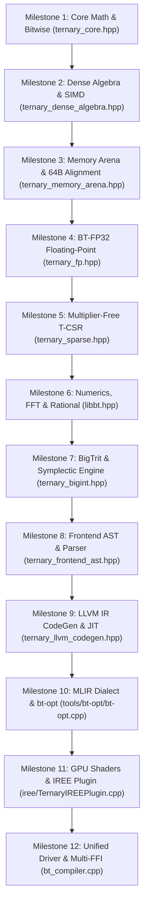
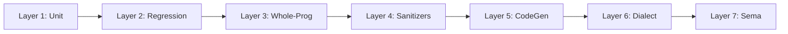

# Chapter 7: Rebuilding This Project from Scratch

If you have ever opened a large, multi-layered compiler codebase and felt a knot of intimidation in your stomach, take a deep breath. You are not alone. Every expert engineer, researcher, and systems architect started right where you are standing today.

Building a compiler and mathematical runtime that bridges base-3 balanced ternary logic with modern 64-bit binary silicon might seem like wizardry. But wizardry, when broken down carefully, is simply a sequence of simple, logical decisions built one on top of another.

In this chapter, we give you the **complete 12-milestone blueprint** to rebuild this entire project from blank files. Whether you are typing this on a MacBook, an Ubuntu workstation, or a cloud server, following these milestones in order guarantees that you will never be stuck wondering what to build next or how to verify that your code works.

---

## 1. Prerequisites & Toolchain Setup

Before writing a single line of code, ensure your host environment has the modern C++20 compiler and scripting tools installed.

### macOS (Apple Silicon M-Series or Intel)
1. **Xcode Command Line Tools**:
   ```bash
   xcode-select --install
   ```
2. **Verify Clang++**:
   ```bash
   clang++ --version
   ```
   *Requirement*: Apple Clang version 14.0 or newer (supports C++20 concepts, `bit_cast`, and stdlib features).
3. **Verify Python**:
   ```bash
   python3 --version
   ```
   *Requirement*: Python 3.8+ (used for the `lit` test runner and FFI verification).

### Linux (Ubuntu, Debian, Fedora, Arch)
1. **Install Toolchain**:
   - Ubuntu / Debian:
     ```bash
     sudo apt-get update && sudo apt-get install -y clang lld python3 build-essential
     ```
   - Fedora / RHEL:
     ```bash
     sudo dnf install -y clang lld python3 gcc-c++
     ```
   - Arch Linux:
     ```bash
     sudo pacman -S clang lld python
     ```
2. **Verify Toolchain**:
   ```bash
   clang++ -std=c++20 -dM -E - < /dev/null | grep -i cplusplus
   ```
   Ensure the output reports `202002L` or newer.

---

## 2. Critical Environment Gotchas Discovered During Development

During the engineering of this compiler, our team encountered four subtle platform traps. Knowing these in advance will save you hours of frustrating debugging:

### Gotcha 1: macOS SDK Path and `SDKROOT`
On macOS, Clang relies on the macOS SDK to resolve standard C and C++ library stubs (`.tbd` files). If the environment variable `SDKROOT` is unset or points to a stale Xcode location, Clang will fail with cryptic linker errors:
```text
ld: library not found for -lSystem
```
or fail inside Xcode's `tapi` text-stub parser.
**The Fix**: Explicitly export `SDKROOT` before compiling or add it to your shell configuration:
```bash
export SDKROOT=/Library/Developer/CommandLineTools/SDKs/MacOSX.sdk
```

### Gotcha 2: Directory Paths with Trailing Spaces
Notice the repository root directory name:
```bash
/Users/mohana/Desktop/Balanced ternary system /
```
There is a trailing space at the end of the folder name! In Bash or Zsh, if a script writes:
```bash
SCRIPT_DIR=$(cd $(dirname $0) && pwd)
clang++ $SCRIPT_DIR/bt_compiler.cpp ...
```
The shell expands `$SCRIPT_DIR` into three separate arguments (`/Users/mohana/Desktop/Balanced`, `ternary`, and `system`), immediately failing with:
```text
clang++: error: no such file or directory: '/Users/mohana/Desktop/Balanced'
```
**The Fix**: Always enclose all variable expansions and script paths in strict double quotes:
```bash
"${SCRIPT_DIR}/bt_compiler.cpp"
```

### Gotcha 3: Exact String Constant Lengths in LLVM IR
When generating LLVM Intermediate Representation (`.ll`), string literals are typed arrays of 8-bit integers (`[N x i8]`).
For example:
```llvm
@.str_int = private unnamed_addr constant [14 x i8] c"%lld [trits]\0A\00", align 1
```
Notice the byte count:
- `%lld [trits]` has 12 characters.
- `\0A` is 1 byte (newline, ASCII 10).
- `\00` is 1 byte (null terminator, ASCII 0).
- Total = $12 + 1 + 1 = 14$ bytes.

If your code generator declares `[13 x i8]` or `[15 x i8]`, LLVM's parser (`llvm-as` or the Clang frontend) will immediately crash with a fatal type error:
```text
error: initializer element type does not match type of global variable
```
Every escaped byte in an LLVM string constant counts as **exactly one byte**, not the number of ASCII characters used to escape it.

### Gotcha 4: `DualRailPlanes` Takes Words, Not Trits
In `ternary_memory_arena.hpp`, the container `DualRailPlanes` allocates 64-bit words:
```cpp
explicit DualRailPlanes(size_t words);
```
Each 64-bit word holds 64 trits (via dual-rail positive $P$ and negative $N$ masks). If a function requires 1,024 trits and you pass `1024` to the constructor, you will allocate $1024 \times 64 = 65,536$ trits!
Conversely, if you pass `16` wanting 16 trits, you allocate 1,024 trits.
**The Fix**: Always convert trit counts to word counts using integer ceiling division:
```cpp
size_t num_words = (num_trits + 63) / 64;
DualRailPlanes planes(num_words);
```

---

## 3. The 12-Milestone Blueprint

Follow these milestones sequentially. Each milestone produces concrete, independently verifiable files.



---

### Milestone 1: Core Mathematical Foundations & Bitwise Primitives
- **Target File**: `ternary_core.hpp`
- **Core Responsibility**: Define the fundamental `Trit` enumeration ($-1, 0, +1$), the dual-rail word representation, the 6-instruction Balanced Ternary Half-Adder (BTHA), the division-free Base-243 reciprocal unpacker, and the Douglas W. Jones SWAR BCT adder tree.
- **Key Signatures**:
  ```cpp
  enum class Trit : int8_t { Neg = -1, Zero = 0, Pos = 1 };
  
  struct TritWord64 {
      uint64_t P{0}; // Positive rail bitmask
      uint64_t N{0}; // Negative rail bitmask
  };
  
  // 6 bitwise instructions: Sum and Carry
  inline void btha_6op(uint64_t P1, uint64_t N1, uint64_t P2, uint64_t N2,
                       uint64_t& S_P, uint64_t& S_N, uint64_t& C_P, uint64_t& C_N) noexcept;
  
  // Division-free Base-243 reciprocal magic unpacker
  inline void unpack_base243_5trits(uint8_t byte_val, int8_t out_trits[5]) noexcept;
  ```
- **Self-Test File**: `test/Unit/test_unit_core.cpp`
- **Build & Verification Command**:
  ```bash
  clang++ -std=c++20 -O3 test/Unit/test_unit_core.cpp -o test/Unit/unit_core
  ./test/Unit/unit_core
  ```
- **Expected Result**: `-> PASSED: All Core Unit Tests Verified.`

---

### Milestone 2: Dual-Rail Planar Dense Linear Algebra & SIMD
- **Target Files**: `ternary_dense_algebra.hpp`, `balanced_ternary_simd.cpp`
- **Core Responsibility**: Provide planar vector and matrix structures (`DenseTernaryVector`, `DenseTernaryMatrix`) that execute dot products using native hardware population counts (`__builtin_popcountll`) without scalar loops. Implement multi-word Carry-Save Adders (CSA) for high-dimensional contractions.
- **Key Signatures**:
  ```cpp
  class DenseTernaryVector {
  public:
      uint64_t* P_{nullptr};
      uint64_t* N_{nullptr};
      size_t num_trits_{0};
      int64_t dot_product(const DenseTernaryVector& other) const noexcept;
  };
  
  inline int64_t dot_product_planar_64(uint64_t pA, uint64_t nA, uint64_t pB, uint64_t nB) noexcept {
      return (int64_t)__builtin_popcountll((pA & pB) | (nA & nB)) -
             (int64_t)__builtin_popcountll((pA & nB) | (nA & pB));
  }
  ```
- **Self-Test File**: `test/Unit/test_unit_dense.cpp`
- **Build & Verification Command**:
  ```bash
  clang++ -std=c++20 -O3 test/Unit/test_unit_dense.cpp -o test/Unit/unit_dense
  ./test/Unit/unit_dense
  ```
- **Expected Result**: `-> PASSED: All Dense Algebra Unit Tests Verified.`

---

### Milestone 3: High-Performance Memory Arena & 64-Byte Cache Alignment
- **Target File**: `ternary_memory_arena.hpp`
- **Core Responsibility**: Custom bump allocator, thread-safe memory arenas, hierarchical zero-page deduplication, and cacheline-aligned dual-rail allocations (`posix_memalign` to 64-byte boundaries for AVX-512 and ARM Neon).
- **Key Signatures**:
  ```cpp
  class TernaryArena {
  public:
      explicit TernaryArena(size_t pool_size_bytes);
      ~TernaryArena();
      void* allocate_aligned(size_t bytes, size_t alignment = 64);
      void reset() noexcept;
  };
  
  class DualRailPlanes {
  public:
      explicit DualRailPlanes(size_t words);
      bool is_aligned_64() const noexcept;
  };
  ```
- **Self-Test File**: `test/Unit/test_unit_memory.cpp`
- **Build & Verification Command**:
  ```bash
  clang++ -std=c++20 -O3 test/Unit/test_unit_memory.cpp -o test/Unit/unit_memory
  ./test/Unit/unit_memory
  ```
- **Expected Result**: `-> PASSED: All Memory Arena Unit Tests Verified.`

---

### Milestone 4: Balanced Ternary Floating-Point (BT-FP32)
- **Target File**: `ternary_fp.hpp`
- **Core Responsibility**: Implement standard BT-FP32 floating point (1 trit sign, 7 trits exponent, 20 trits mantissa). Provide zero-bias round-to-nearest rounding, IEEE 754 conversion, and float addition and multiplication.
- **Key Signatures**:
  ```cpp
  class BTFP32 {
  public:
      int8_t sign{0};        // -1, 0, +1
      int16_t exponent{0};   // Balanced ternary exponent
      int64_t mantissa{0};   // 20-trit significand
      
      static BTFP32 from_float(float val) noexcept;
      float to_float() const noexcept;
      BTFP32 operator+(const BTFP32& rhs) const noexcept;
      BTFP32 operator*(const BTFP32& rhs) const noexcept;
  };
  ```
- **Self-Test File**: `test/Unit/test_unit_fp_sparse.cpp`
- **Build & Verification Command**:
  ```bash
  clang++ -std=c++20 -O3 test/Unit/test_unit_fp_sparse.cpp -o test/Unit/unit_fp_sparse
  ./test/Unit/unit_fp_sparse
  ```
- **Expected Result**: `-> PASSED: All FP and Sparse Unit Tests Verified.`

---

### Milestone 5: Multiplier-Free Sparse Linear Algebra (T-CSR)
- **Target File**: `ternary_sparse.hpp`
- **Core Responsibility**: Ternary Compressed Sparse Row (T-CSR) matrix format. Because non-zero values in ternary are strictly $+1$ or $-1$, values are stored in a single 1-bit sign plane. SpMV executes without hardware multipliers via branchless addition or subtraction.
- **Key Signatures**:
  ```cpp
  class TernaryCSRMatrix {
  public:
      std::vector<uint32_t> row_ptrs;
      std::vector<uint32_t> col_indices;
      std::vector<uint8_t>  sign_plane; // 0 for -1, 1 for +1
      
      void spmv(const double* x, double* y) const noexcept;
  };
  ```
- **Self-Test File**: Verified inside `test/Unit/test_unit_fp_sparse.cpp`.

---

### Milestone 6: High-Performance Numerics, FFT & Exact Rational Arithmetic
- **Target File**: `libbt.hpp`
- **Core Responsibility**: Cooley-Tukey Radix-3 Fast Fourier Transform (FFT) butterfly kernels operating in $O(N \log_3 N)$ time, and exact arbitrary rational arithmetic (`ExactRational`) with canonical Euclidean GCD normalization.
- **Key Signatures**:
  ```cpp
  class ExactRational {
  public:
      int64_t num{0};
      int64_t den{1};
      void canonicalize() noexcept;
      ExactRational operator+(const ExactRational& o) const noexcept;
  };
  
  namespace Radix3FFT {
      void fft_3pt(std::complex<double>& a, std::complex<double>& b, std::complex<double>& c) noexcept;
      void fft_recursive(std::vector<std::complex<double>>& data) noexcept;
  }
  ```
- **Self-Test File**: `test/Unit/test_unit_libbt.cpp`
- **Build & Verification Command**:
  ```bash
  clang++ -std=c++20 -O3 test/Unit/test_unit_libbt.cpp -o test/Unit/unit_libbt
  ./test/Unit/unit_libbt
  ```
- **Expected Result**: `-> PASSED: All libbt Numerics & FFT Unit Tests Verified.`

---

### Milestone 7: Arbitrary-Precision BigTrit & Symplectic Physics
- **Target Files**: `ternary_bigint.hpp`, `symplectic_ternary_engine.hpp`
- **Core Responsibility**: Multi-word arbitrary-precision balanced ternary integers (`TernaryBigInt<4>` for 256 trits) with multi-word carry propagation. Symplectic Hamiltonian leapfrog integrator preserving energy and phase-space volume for physical dynamics.
- **Key Signatures**:
  ```cpp
  template <size_t Words = 4>
  class TernaryBigInt {
  public:
      std::array<uint64_t, Words> P{};
      std::array<uint64_t, Words> N{};
      void add(const TernaryBigInt& rhs) noexcept;
  };
  
  class SymplecticTernaryEngine {
  public:
      void step_leapfrog(double dt) noexcept;
      double compute_energy() const noexcept;
  };
  ```
- **Self-Test File**: `test/Unit/test_unit_bigint_symplectic.cpp`
- **Build & Verification Command**:
  ```bash
  clang++ -std=c++20 -O3 test/Unit/test_unit_bigint_symplectic.cpp -I. -o test/Unit/unit_bigint_symplectic
  ./test/Unit/unit_bigint_symplectic
  ```
- **Expected Result**: `-> PASSED: All BigInt and Symplectic Unit Tests Verified.`

---

### Milestone 8: Frontend Compiler: Lexer, Parser & Semantic Type Checker
- **Target File**: `ternary_frontend_ast.hpp`
- **Core Responsibility**: Complete recursive descent parser and lexer for the `.bt` language. Handles balanced ternary literals (`+0-`), three-way spaceship comparisons (`<=>`), floating-point variables, sparse matrix declarations, and semantic type checking.
- **Key Signatures**:
  ```cpp
  enum class TokenType { Tok_Trit, Tok_Float, Tok_Sparse, Tok_Spaceship, Tok_Ident, ... };
  
  class ASTNode { public: virtual ~ASTNode() = default; };
  class FunctionAST : public ASTNode { ... };
  class VarDeclAST : public ASTNode { ... };
  class TypeChecker {
  public:
      bool check_module(const std::vector<std::unique_ptr<ASTNode>>& nodes);
  };
  ```
- **Self-Test File**: `test/Unit/test_unit_ast.cpp`
- **Build & Verification Command**:
  ```bash
  clang++ -std=c++20 -O3 test/Unit/test_unit_ast.cpp -o test/Unit/unit_ast
  ./test/Unit/unit_ast
  ```
- **Expected Result**: `-> PASSED: All Frontend AST Unit Tests Verified.`

---

### Milestone 9: LLVM Code Generator & JIT Execution Pipeline
- **Target Files**: `ternary_llvm_codegen.hpp`, `ternary_jit_engine.hpp`
- **Core Responsibility**: Walk the validated AST and emit valid LLVM 15+ Intermediate Representation (`.ll`). Includes DWARF-5 debug metadata, loop vectorization pragmas, runtime function declarations, and native JIT execution via Clang.
- **Key Signatures**:
  ```cpp
  class LLVMIRGenerator {
  public:
      std::string generate_module_ir(const std::vector<std::unique_ptr<ASTNode>>& ast);
      void emit_string_constant(const std::string& name, const std::string& val);
  };
  
  class NativeLLVMJIT {
  public:
      int compile_and_run(const std::string& llvm_ir);
  };
  ```
- **Self-Test File**: `test/Unit/test_unit_frontend_fp_sparse.cpp`
- **Build & Verification Command**:
  ```bash
  clang++ -std=c++20 -O3 test/Unit/test_unit_frontend_fp_sparse.cpp -o test/Unit/unit_frontend_fp_sparse
  ./test/Unit/unit_frontend_fp_sparse
  ```
- **Expected Result**: `-> ALL 11 FRONTEND FP & SPARSE MATRIX UNIT TESTS PASSED (100%)`

---

### Milestone 10: MLIR Dialect, Lowering Passes & `bt-opt` Tool
- **Target Files**: `TernaryDialect.td`, `TernaryOps.td`, `lib/Ternary/TernaryDialect.cpp`, `lib/Ternary/TernaryPasses.cpp`, `tools/bt-opt/bt-opt.cpp`, `ternary_mlir_lowering.hpp`
- **Core Responsibility**: Declare the `bt` MLIR dialect using LLVM TableGen. Implement dialect operations (`bt.btha`, `bt.dot`), conversion patterns lowering `bt` to `linalg.generic` and `vector.contract` (Larq-style bit-sliced POPCNT), and compile the `bt-opt` command-line optimizer.
- **Key Signatures**:
  ```cpp
  namespace mlir::bt {
      class TernaryDialect : public mlir::Dialect { ... };
      void registerTernaryPasses();
  }
  ```
- **Build & Verification Commands**:
  ```bash
  clang++ -std=c++20 -O3 \
      lib/Ternary/TernaryDialect.cpp \
      lib/Ternary/TernaryPasses.cpp \
      iree/TernaryIREEPlugin.cpp \
      tools/bt-opt/bt-opt.cpp \
      -o bt-opt
  
  clang++ -std=c++20 -O3 \
      lib/Ternary/TernaryDialect.cpp \
      lib/Ternary/TernaryPasses.cpp \
      iree/TernaryIREEPlugin.cpp \
      test/Unit/test_unit_bt_opt.cpp \
      -o test/Unit/unit_bt_opt
  ./test/Unit/unit_bt_opt
  ```
- **Expected Result**: `-> PASSED: All bt-opt Dialect & Passes Verified.`

---

### Milestone 11: Heterogeneous Acceleration & GPU Pipelines
- **Target Files**: `iree/TernaryIREEPlugin.cpp`, `iree/TernaryIREEPlugin.h`, `ternary_kokkos_bridge.hpp`, `gemm_kernel.metal`, `gemm_shader.comp`
- **Core Responsibility**: Provide IREE runtime plugins and Kokkos parallel execution bridges. Emit production-ready compute shaders for Apple Metal (`gemm_kernel.metal`) and Vulkan SPIR-V (`gemm_shader.comp`) that perform 64-way parallel POPCNT contractions directly in SIMD threadgroups.
- **Self-Test File**: Verified via `test/lit_runner.py` on `test/CodeGen/target_metal.test` and `test/CodeGen/target_vulkan.test`.

---

### Milestone 12: Unified Driver, C-ABI Runtime & Multi-Language FFI
- **Target Files**: `bt_compiler.cpp`, `lib/Ternary/ternary_c_abi.cpp`, `libbt_runtime.dylib`, `ffi/python/bt_ffi.py`, `ffi/rust/Cargo.toml`
- **Core Responsibility**: Compile the main command-line compiler executable (`bt-compiler`), produce the shared C-ABI runtime (`libbt_runtime.dylib`), and provide seamless Python ctypes and Rust FFI wrappers.
- **Build Commands**:
  ```bash
  # 1. Main Compiler Executable
  clang++ -std=c++20 -O3 bt_compiler.cpp -o bt-compiler
  
  # 2. Shared C-ABI Dynamic Library
  clang++ -std=c++20 -O3 -shared -fPIC lib/Ternary/ternary_c_abi.cpp -I. -o libbt_runtime.dylib
  
  # 3. C-ABI Unit Test
  clang++ -std=c++20 -O3 test/Unit/test_unit_c_abi_ffi.cpp -I. -L. -lbt_runtime -Wl,-rpath,. -o test/Unit/unit_c_abi_ffi
  ./test/Unit/unit_c_abi_ffi
  
  # 4. Python FFI Self-Test
  python3 ffi/python/bt_ffi.py
  ```
- **Self-Test Embedded In Driver**:
  ```bash
  ./bt-compiler --test
  ```
- **Expected Result**: `ALL COMPILER SELF-TESTS PASSED WITH 0 FAILURES.`

---

## 4. Running the 7 LLVM Testing Layers (`run_all_tests.sh`)

In LLVM-style compiler engineering, testing is organized into concentric verification layers. The master script `run_all_tests.sh` executes all 7 layers in sequence:



To run the complete test suite:
```bash
./run_all_tests.sh
```

### Breakdown of the 7 Layers:
1. **Layer 1: Unit Tests (`test/Unit/`)**:
   Runs 11 individual binary test runners validating core bitwise math, memory arenas, floating point, sparse algebra, FFT, BigTrit, and C-ABI FFI.
2. **Layer 2: Regression Tests (`test/Regression/`)**:
   Uses `test/lit_runner.py` to compile `.bt` programs like `test/Regression/sample_exec.bt`, `test/Regression/select_spaceship.bt`, and `test/Regression/matmul_check.bt`, verifying exact output with `FileCheck`.
3. **Layer 3: Whole-Program Tests (`test/WholeProgram/`)**:
   Compiles and links multi-stage pipelines (`test/WholeProgram/matrix_pipeline.bt`) into standalone executables.
4. **Layer 4: Compiler-RT Sanitizers (`test/Sanitizers/run_sanitizers.sh`)**:
   Instruments all core modules with `-fsanitize=address,undefined -fno-omit-frame-pointer` to guarantee zero memory leaks, zero buffer overflows, and zero undefined behavior.
5. **Layer 5: Target CodeGen Tests (`test/CodeGen/`)**:
   Verifies multi-target assembly generation for ARM64, x86_64, LLVM IR, Metal, and Vulkan (`test/CodeGen/target_arm64.test`, `test/CodeGen/target_x86.test`).
6. **Layer 6: MLIR Dialect Tests (`test/Dialect/`)**:
   Uses `bt-opt` to verify MLIR canonicalization passes and lowering to Linalg (`test/Dialect/bt_opt_lowering.mlir`).
7. **Layer 7: Semantic & Diagnostic Tests (`test/Sema/`)**:
   Ensures that invalid programs (`test/Sema/diagnostic_error.bt`) trigger graceful compiler diagnostics, while valid declarations (`test/Sema/valid_declarations.bt`) succeed cleanly.

---

## 5. Troubleshooting Table: Real Compiler & Linker Errors

When rebuilding from scratch, you may encounter one of these real errors. Here is how to diagnose and resolve each one instantly:

| Error Message / Symptom | Root Cause | Exact Solution |
| :--- | :--- | :--- |
| `ld: library not found for -lSystem` or `.tbd` parse error | macOS SDK path is missing or points to stale Xcode directory. | Run `export SDKROOT=/Library/Developer/CommandLineTools/SDKs/MacOSX.sdk`. |
| `clang++: error: no such file or directory: '.../Balanced'` | Shell path expansion broke on the space in `Balanced ternary system `. | Wrap all path variables in quotes: `"${SCRIPT_DIR}/bt_compiler.cpp"`. |
| `initializer element type does not match type of global variable` | String constant length in LLVM IR does not match `[N x i8]` byte count. | Count characters + `\0A` (1 byte) + `\00` (1 byte) exactly. |
| Memory allocation 64x larger than expected | Calling `DualRailPlanes(N)` with a trit count instead of word count. | Compute words first: `DualRailPlanes((N + 63) / 64)`. |
| `dyld: Library not loaded: @rpath/libbt_runtime.dylib` | Dynamic linker cannot locate shared library at runtime. | Pass `-Wl,-rpath,.` or `-Wl,-rpath,"${SCRIPT_DIR}"` during linking. |
| `ASan: stack-buffer-overflow` or unaligned pointer error | Memory allocated without 64-byte alignment passed to SIMD / POPCNT routine. | Use `posix_memalign` with 64-byte alignment or `TernaryArena`. |
| `bt-opt: command not found` | The MLIR tool was not built prior to running dialect tests. | Run the Milestone 10 build command before executing `test/lit_runner.py`. |

---

### Check Yourself!
1. Why must `SDKROOT` be explicitly exported when compiling on macOS?
2. If an LLVM IR string literal is `c"Hello World\0A\00"`, what must the type declaration `[N x i8]` be?
3. What is the difference between passing `64` to `DualRailPlanes` versus wanting to store 64 trits?
4. What are the two sanitizers executed in Layer 4, and what defects do they catch?

*(Answers: 1. Because Apple Clang needs to find the `.tbd` system text stubs in the Command Line Tools SDK to link `libSystem`. 2. `[13 x i8]`, because `"Hello World"` is 11 bytes + 1 newline byte (`\0A`) + 1 null terminator byte (`\00`). 3. `DualRailPlanes(64)` allocates 64 sixty-four-bit words, which stores $64 \times 64 = 4096$ trits; to store 64 trits, pass `(64 + 63) / 64 = 1` word. 4. AddressSanitizer (ASan) catches buffer overflows, out-of-bounds accesses, and memory leaks; UndefinedBehaviorSanitizer (UBSan) catches integer overflows, misaligned pointers, and undefined language constructs).*
